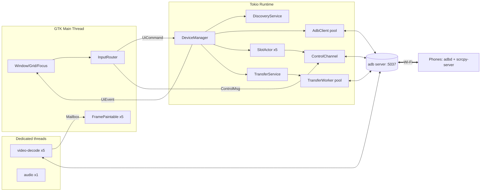

# Android Controller — Technical Specification

| Field            | Value                                                              |
|------------------|--------------------------------------------------------------------|
| Document         | `spec.md` — architecture & implementation specification            |
| Version          | 1.0                                                                |
| Date             | 2026-10-23                                                         |
| Product name     | Android Controller                                                 |
| Binary           | `android-controller`                                               |
| Application ID   | `org.androidcontroller.AndroidController`                          |
| Target host      | Arch Linux x86_64 / aarch64, Wayland (primary) and X11             |
| Target devices   | Android 11+ (wireless debugging, TLS) and Android 5–10 (legacy `adb tcpip`) |
| Max devices      | 5 concurrent                                                       |

### Baseline host stack (verified against current Arch repos)

| Package         | Version on reference host | Minimum required | Why the minimum                                         |
|-----------------|---------------------------|------------------|---------------------------------------------------------|
| `gtk4`          | 4.22.4                    | 4.16             | `GdkDmabufTextureBuilder` + `GtkGraphicsOffload` stable |
| `libadwaita`    | 1.9.3                     | 1.6              | `AdwDialog`, `AdwToolbarView`, `AdwBottomSheet`         |
| `ffmpeg`        | 9.0.1                     | 7.1              | VA-API HEVC + `AV_CODEC_FLAG_LOW_DELAY` hwaccel paths   |
| `scrcpy`        | 4.1                       | 4.0 (exact match at runtime, see §4.1) | session-packet video protocol, `SCAN_FILE` control msg |
| `android-tools` | 37.0.0                    | 34.0             | `host:pair`, TLS transport, mDNS service types          |

---

## Table of Contents

1. System Overview & Tech Stack Selection
2. System Architecture & Concurrency Model
3. Network Discovery & Connection Lifecycle
4. Screen Streaming & Input Injection Protocol
5. Drag-and-Drop File Transfer Pipeline
6. User Interface & UX Wireframe
7. Project Directory Structure & Data Schemas
8. Arch Linux Packaging & Dependencies
9. Implementation Roadmap & Verification Plan
- Appendix A — Error Codes
- Appendix B — Security Model
- Appendix C — Performance Budgets

---

## 1. System Overview & Tech Stack Selection

### 1.1 Product summary

Android Controller is a native GTK4 desktop application. It discovers Android phones on
the local Wi-Fi network, pairs and connects to them over Wireless ADB, and shows up to five
live, hardware-decoded screen mirrors at once. Each mirror takes mouse, touchpad and keyboard
input. The user can focus one device at full frame rate, broadcast input to a chosen set of
devices, and drag files from any Linux file manager onto a device to push them (or to install
them, for APKs).

### 1.2 Selected stack: Rust + GTK4 + libadwaita + FFmpeg/VA-API

| Layer                  | Choice                                                           |
|------------------------|------------------------------------------------------------------|
| Language               | Rust, edition 2024, MSRV 1.85                                    |
| UI toolkit             | GTK 4 (`gtk4` crate 0.11, feature `v4_16`) + libadwaita (`libadwaita` crate 0.9, feature `v1_6`); widgets built in Rust code (no Blueprint step) |
| Async runtime          | `tokio` 1.x multi-thread runtime (network, ADB, transfers)       |
| UI ↔ runtime bridge    | `async-channel` 2.x, received on the GLib main loop via `glib::spawn_future_local` |
| Video decode           | FFmpeg `libavcodec` via `ffmpeg-sys-next` (raw FFI, matches system FFmpeg major) |
| HW acceleration        | VA-API (`libva`), exporting DRM PRIME dma-bufs (NVIDIA through `libva-nvidia-driver`) |
| GPU presentation       | `GdkDmabufTexture` → GSK renderer (Vulkan or NGL) and `GtkGraphicsOffload` (Wayland subsurfaces) |
| Audio (optional)       | PipeWire native stream via `pipewire` crate 0.8; Opus decoded by libavcodec |
| mDNS                   | Avahi over D-Bus via `zbus` 5.x; fallback embedded responder `mdns-sd` 0.21 (not yet implemented — Milestone 4 polish) |
| ADB                    | Native Rust client for the ADB server smart-socket protocol (no `adb` CLI subprocesses in hot paths) |
| Device agent           | Upstream `scrcpy-server` from the Arch `scrcpy` package (not vendored) |
| Config                 | TOML (`serde` + `toml` 0.9), XDG paths via `directories` 6.x. Partial `[profiles.*]` and `[keybindings]` tables merge key-by-key over the built-in defaults |
| Logging                | `tracing` + `tracing-subscriber` (journald when stdout is not a TTY, via `tracing-journald`) |

#### Why this stack

1. **GTK4 is the only mainstream toolkit with first-class dma-buf textures and graphics offload.**
   `GdkDmabufTextureBuilder` (GTK ≥ 4.14) wraps a VA-API surface exported as DRM PRIME *without
   copying*. GSK samples it directly (Vulkan or EGL import, including NV12 via the GPU's YUV
   sampler). On Wayland, `GtkGraphicsOffload` can hand the buffer to the compositor as a
   subsurface, so a focused 60 fps stream may skip GTK's composition pass entirely. Qt6 can
   reach this through `QRhi`/QML video sinks, but only with substantially more glue code.
2. **Wayland and X11 come from the same code path.** GDK abstracts both display servers,
   including drag-and-drop (Wayland `wl_data_device` vs X11 XDND), clipboard, and HiDPI
   fractional scaling (`wp_fractional_scale_v1`).
3. **Rust fits the concurrency profile.** The app is 5 × (video + control + optional audio) sockets,
   one shared ADB server connection pool and a file transfer worker pool. That is a heavily
   concurrent I/O program. Rust's ownership model removes data races between decode threads and
   the UI, and `tokio` fits the ADB/network workload.
4. **Tauri/WebView was rejected.** WebKitGTK cannot take a dma-buf from our decoder without a copy
   into a `<video>`/WebCodecs pipeline. Its DnD gives sandboxed `File` blobs rather than paths.
   Its input latency is also worse.
5. **iced was rejected.** It has no dma-buf texture import, and its native DnD (file drop only, no
   per-widget target or modifier/action reporting) is too limited for per-viewport drops.

### 1.3 Interface with ADB

- The app speaks the **ADB server smart-socket protocol** directly over TCP to the local ADB
  server (`127.0.0.1:5037`, configurable). It does not spawn `adb` for each operation. This gives:
  - streaming SYNC with accurate per-byte progress and cancellation,
  - concurrent streams per device without process-spawn overhead,
  - structured errors instead of parsing CLI output.
- The ADB server process itself comes from `android-tools` (`/usr/bin/adb`). On startup the app
  sends `host:version`. If the connection is refused, it runs `adb start-server` once (the only
  subprocess, besides `scrcpy --version`). It shares the user's standard ADB server and
  `~/.android/adbkey`, so `adb` on the CLI sees the same devices and existing pairings stay valid.
- Smart-socket framing: the request is `<4 hex digits length><payload>`. The response is `OKAY`, or
  `FAIL<4 hex len><message>`. Some services report failure *after* `OKAY` with a nested
  `FAIL<len><msg>` (observed for `host:pair` on android-tools 37:
  `OKAYFAIL0027Failed: Unable to start pairing client.`); the string reader treats that as a failure. Host services used:

| Service                                                | Purpose                                 |
|--------------------------------------------------------|-----------------------------------------|
| `host:version`                                         | Liveness/compat check (require ≥ 41)    |
| `host:track-devices-l`                                 | Push stream of device list changes      |
| `host:pair:<code>:<ip>:<port>`                         | TLS pairing (6-digit code or QR password)|
| `host:connect:<ip>:<port>`                             | Connect TLS or legacy transport         |
| `host:disconnect:<ip>:<port>`                          | Explicit disconnect                     |
| `host:mdns:check`                                      | Determine whether ADB's own mDNS backend is active |
| `host-serial:<serial>:features`                        | Device feature list (`shell_v2`, `abb_exec`, `stat_v2`, `sendrecv_v2`, …) |
| `host-serial:<serial>:forward:tcp:0;localabstract:<name>` | Create tunnel; server replies `OKAY` `OKAY` `<4hex len><port>` |
| `host-serial:<serial>:killforward:tcp:<port>`          | Tear down tunnel                        |
| `host:transport:<serial>` then a device service        | Open a device stream                    |

  Device services used after `host:transport:<serial>`: `shell,v2,raw:<cmd>` (or `shell:<cmd>`
  if `shell_v2` is missing), `exec:<cmd>`, `sync:`, `tcpip:5555`, `abb_exec:<args NUL-separated>`.

### 1.4 Interface with screen capture: `scrcpy-server`

The device-side agent is the upstream **`scrcpy-server`** (Apache-2.0) from the Arch `scrcpy`
package at `/usr/share/scrcpy/scrcpy-server`. The app pushes it to
`/data/local/tmp/android-controller-server.jar` and runs it with `app_process`. The agent:

- captures the display via a `VirtualDisplay`/`SurfaceControl` into `MediaCodec` hardware encoders
  (H.264/H.265/AV1), which gives low-latency, change-driven encoding (frames repeat every 100 ms when static);
- injects input through privileged `InputManager` calls (shell UID), so no APK install and no
  accessibility service are needed;
- syncs the clipboard and requests MediaStore scans (`SCAN_FILE`, used in §5.8).

`adb exec-out screencap` polling is explicitly **not** used: it costs 150–600 ms per PNG frame,
uses lots of CPU on both ends, and is unusable for 5 devices.

**Version coupling.** The scrcpy protocol is internal and changes between releases, so the client
must pass the exact server version string. At startup the app runs `scrcpy --version` once, parses
the first line (`^scrcpy (\d+\.\d+(\.\d+)?) `), and stores it as `server_version`. The app
implements the **4.x wire protocol** (§4). If the major version is not `4`, every slot shows error
`E_SERVER_INCOMPATIBLE` with the detected version, and streaming is disabled (ADB management and file
transfer still work). A pacman hook is not needed: the check runs on every launch.

### 1.5 Video decoding path

```
socket bytes ──► scrcpy demuxer ──► AVPacket ──► avcodec (hwaccel=vaapi)
            ──► VASurface ──► vaExportSurfaceHandle(DRM_PRIME_2, COMPOSED_LAYERS)
            ──► GdkDmabufTextureBuilder (fourcc NV12 + modifier) ──► GdkPaintable ──► GSK / Offload
```

Three decoder backends are chosen automatically (`video.decoder = "auto"`) by probing at startup:

| Backend         | When chosen                                           | Frame path                                   |
|-----------------|-------------------------------------------------------|----------------------------------------------|
| `vaapi-dmabuf`  | VA-API device opens, profile supported, and `gdk_display_get_dmabuf_formats()` contains `NV12` with the exported modifier | zero-copy dma-buf → `GdkDmabufTexture` |
| `vaapi-copy`    | VA-API decodes but the dma-buf import fails (seen on some NVIDIA + NGL combos) | `av_hwframe_transfer_data` → NV12 in RAM → `sws_scale` to BGRA at *display size* → `GdkMemoryTexture` |
| `software`      | No usable VA-API                                      | libavcodec SW decode (`thread_type=SLICE`, 2 threads) → `sws_scale` → `GdkMemoryTexture` |

The probe decodes a 64×64 embedded H.264 IDR frame (compiled into the binary, `assets/probe.h264`)
and test-imports the result. The chosen backend is logged and shown in *Preferences → About → Diagnostics*.

---

## 2. System Architecture & Concurrency Model

### 2.1 Component diagram

```
┌──────────────────────────────── GTK MAIN THREAD (GLib main loop) ─────────────────────────────────┐
│                                                                                                   │
│  AdwApplicationWindow                                                                             │
│   ├─ Toolbar (Add / Pair / Grid⇄Focus / Broadcast / Settings)                                     │
│   ├─ GridView (custom GtkLayoutManager: 5 × DeviceTile)                                           │
│   │     DeviceTile = GtkOverlay{ GtkGraphicsOffload{ GtkPicture(FramePaintable) },                │
│   │                              StatusStrip, TransferOverlay, DropHighlight }                    │
│   ├─ FocusView (one DeviceTile at full size + HardwareButtonRail)                                 │
│   └─ InputRouter  ── GTK event controllers → InputEvent → (single target | broadcast fan-out)     │
│                                                                                                   │
│  FramePaintable.tick(): take latest frame from Mailbox[slot] → build GdkTexture → invalidate      │
└───────▲───────────────────────────┬────────────────────────────────────────▲─────────────────────┘
        │ UiEvent (async-channel)   │ UiCommand (async-channel)              │ Mailbox (Arc, lock-free swap)
        │                           ▼                                        │
┌───────┴────────────────────── TOKIO RUNTIME (4 worker threads) ──────────────────────────────────┐
│                                                                                                   │
│  DeviceManager (actor)                                                                            │
│   ├─ DiscoveryService ── Avahi D-Bus browsers (_adb-tls-pairing / _adb-tls-connect / _adb)        │
│   ├─ AdbClient pool ──── TCP 127.0.0.1:5037 (smart sockets), track-devices-l watcher              │
│   ├─ SlotActor[1..5] ─── state machine (§3), heartbeat, stats poller                              │
│   │     ├─ ControlChannel: writer task (coalescing queue) + reader task (device msgs)             │
│   │     └─ ServerProcess: shell,v2 stream running app_process (stdout/stderr → tracing)           │
│   └─ TransferService ─── job queue, Semaphore(global=4), Semaphore(per-device=2), journal         │
│         └─ TransferWorker × N (SYNC SEND, segment commit, APK streamed install)                    │
│                                                                                                   │
└───────────────────────────────┬──────────────────────────────────────────────────────────────────┘
                                │ spawns / owns JoinHandle
                                ▼
┌────────── DEDICATED OS THREADS (one set per active slot, max 5) ─────────────────────────────────┐
│  video-decode-<slot>  : blocking read(video socket) → demux → avcodec(VA-API) → export → Mailbox │
│  audio-<slot>         : blocking read(audio socket) → Opus decode → PipeWire stream (focus only) │
└──────────────────────────────────────────────────────────────────────────────────────────────────┘
                                │
                                ▼   (all device traffic multiplexed by the ADB server)
                     adb server :5037 ══ TLS/TCP over Wi-Fi ══► adbd on each phone
                                                               └─ scrcpy-server (app_process)
```

The same view in Mermaid, for rendered documentation:



### 2.2 Threads and ownership

| Thread / task              | Count        | Owns                                             | Must never                    |
|----------------------------|--------------|--------------------------------------------------|-------------------------------|
| GTK main thread            | 1            | All widgets, `GdkTexture` creation, clipboard    | block > 2 ms; touch sockets   |
| Tokio workers              | 4            | DeviceManager, SlotActors, control I/O, transfers, discovery | run FFmpeg calls |
| `video-decode-<slot>`      | ≤ 5          | video `TcpStream` (blocking), `AVCodecContext`, VA surfaces in flight | call GTK APIs   |
| `audio-<slot>`             | ≤ 1 (focused device only) | audio `TcpStream`, Opus decoder, `pw::Stream` | —                   |
| `tokio::task::spawn_blocking` | on demand | host file reads during transfers (1 MiB blocks), SHA-256 | —                 |

### 2.3 Message types (crate `ac-core`)

```rust
pub type SlotId = u8; // 1..=5

pub enum UiCommand {
    Connect { slot: SlotId, target: ConnectTarget },
    Disconnect { slot: SlotId, forget: bool },
    PairWithCode { service: MdnsService, code: String },          // 6 digits
    PairWithQr { session: QrPairingSession },
    SetViewMode(ViewMode),                                        // Grid | Focus(SlotId)
    SetGridTileSize { slot: SlotId, px: (u32, u32) },             // physical pixels
    Input { targets: TargetSet, event: InputEvent },             // TargetSet = bitmask of slots
    HardwareKey { targets: TargetSet, key: HwKey, action: KeyAction },
    EnqueueTransfer { slot: SlotId, files: Vec<PathBuf>, mode: DropMode },
    CancelTransfer { job: JobId },
    SetDisplayPower { slot: SlotId, on: bool },
    PasteHostClipboard { slot: SlotId, text: String, paste: bool },
}

pub enum UiEvent {
    SlotState { slot: SlotId, state: SlotStateView },             // §3
    Discovered(Vec<DiscoveredDevice>),
    Stats { slot: SlotId, stats: DeviceStats },                   // 1 Hz
    DeviceClipboard { slot: SlotId, text: String },
    Transfer { job: JobId, slot: SlotId, progress: TransferProgress },
    Toast { severity: Severity, message: String, code: ErrorCode },
}

pub struct DeviceStats {
    pub battery_pct: Option<u8>, pub charging: bool,
    pub wifi_rssi_dbm: Option<i16>, pub wifi_link_mbps: Option<u32>,
    pub rtt_ms: Option<u32>,          // ADB shell echo round-trip
    pub fps_decoded: f32, pub fps_presented: f32, pub frames_dropped: u32,
    pub video_kbps: u32,              // measured on socket, 1 s window
    pub video_lag_ms: Option<u32>,    // §3.6 lag estimator
}
```

### 2.4 Decoding 5 concurrent streams without saturating the CPU or blocking the UI

1. **Fixed-function decode.** Each slot has its own `AVCodecContext` with `hw_device_ctx` taken
   from **one shared** `AVHWDeviceContext` (VA-API, render node chosen per §7.3 `video.vaapi_device`).
   Settings: `extra_hw_frames = 6`, `flags |= AV_CODEC_FLAG_LOW_DELAY`, `flags2 |= AV_CODEC_FLAG2_FAST`,
   `thread_count = 1` (frame threading adds a frame of latency per thread and is pointless with hwaccel).
   Intel Quick Sync (Gen9+), AMD VCN 2+ and NVDEC all decode well over 1 Gpx/s of H.264/HEVC. The worst case
   for this app (one 1080×2400@60 focus stream plus four 1280-max grid streams @30) is about 290 Mpx/s (Appendix C).
2. **Zero-copy export.** After `avcodec_receive_frame`, the decode thread calls `vaSyncSurface`,
   then `vaExportSurfaceHandle(display, surface, VA_SURFACE_ATTRIB_MEM_TYPE_DRM_PRIME_2,
   VA_EXPORT_SURFACE_READ_ONLY | VA_EXPORT_SURFACE_COMPOSED_LAYERS, &desc)`. That yields one layer,
   fourcc `NV12`, 2 planes, a DRM format modifier, and fds. The `AVFrame` is ref-counted and moved,
   together with the descriptor, into a `DecodedFrame`. Its `Drop` closes the fds and unrefs the frame,
   which returns the VA surface to the pool.
3. **Latest-wins mailbox, no queue.** `Mailbox` is `arc_swap::ArcSwapOption<DecodedFrame>` plus an
   `AtomicBool needs_present`. The decoder stores the newest frame. If the previous frame was never
   presented, it is dropped (`frames_dropped += 1`). The surface pool can therefore never run dry:
   at most 1 frame is waiting in the mailbox, 1–2 are held by GSK, and 1 is being decoded, well
   under `extra_hw_frames`.
4. **Wake-ups coalesced to the frame clock.** When the decoder flips `needs_present` from `false` to
   `true`, it calls `glib::MainContext::default().invoke(...)` once. The closure only calls
   `paintable.invalidate_contents()`. The texture is built lazily in `FramePaintable::snapshot()`
   during GTK's paint, using `GdkDmabufTextureBuilder` with `set_fd/offset/stride` per plane,
   `set_fourcc(DRM_FORMAT_NV12)`, `set_modifier(desc.objects[0].drm_format_modifier)`,
   `set_premultiplied(false)`, and color state `GDK_COLOR_STATE_SRGB`, with BT.709 limited range
   taken from the VUI. A release closure drops the `DecodedFrame`. However many frames 5 decoders
   produce, the UI does at most one paint per monitor refresh, and the main thread does only O(1)
   wrapping work per tile.
5. **GPU scaling.** Grid tiles are smaller than the decoded frames. GSK scales them with a linear
   filter (`gtk_picture_set_content_fit(GTK_CONTENT_FIT_CONTAIN)`). Streams are already sized close
   to the tile (§4.3), so overdraw is minimal.
6. **Graphics offload on Wayland.** Each `GtkPicture` is wrapped in `GtkGraphicsOffload` (enabled by
   default; `video.graphics_offload = "auto"`). Where the compositor supports `wl_subcompositor` +
   `zwp_linux_dmabuf_v1` with the right format/modifier (Hyprland, Mutter, KWin all do), the buffer is
   attached to a subsurface and GTK does not composite it. On X11, offload is a no-op, and GSK
   composites through EGL dma-buf import.
7. **Back-pressure isolation.** A slow decoder only fills *its own* TCP socket buffer, which
   eventually throttles its own ADB stream. Other slots are unaffected (§3.6 explains how ADB stream
   flow control interacts with this).

CPU estimate (`vaapi-dmabuf`): socket read + demux + ioctl ≈ 1–2 % of one core per stream. That is
under 10 % of a core in total for 5 streams, and the main thread stays below 15 % (Appendix C).

---

## 3. Network Discovery & Connection Lifecycle

### 3.1 Discovery

**mDNS service types browsed** (Avahi `org.freedesktop.Avahi.Server2.ServiceBrowserPrepare`,
interface `-1` / protocol `-1`, i.e. all interfaces, IPv4 and IPv6):

| Service type             | Advertised by phone when                              | Instance name format          |
|--------------------------|-------------------------------------------------------|-------------------------------|
| `_adb-tls-pairing._tcp`  | "Pair device with pairing code" dialog open, or a QR code was scanned | `adb-<serial>-<6 chars>` (code), or the QR `S:` name |
| `_adb-tls-connect._tcp`  | Wireless debugging enabled and device is paired-able  | `adb-<serial>-<6 chars>`      |
| `_adb._tcp`              | Some legacy ROMs / emulators after `adb tcpip`        | free-form                     |

Each `ItemNew` is resolved with `ServiceResolverPrepare` (address family preference: IPv4 first). It
becomes a `DiscoveredDevice { instance, service_type, addr: SocketAddr, txt: BTreeMap, iface, last_seen }`.
`ItemRemove` marks it stale. Stale entries are kept for 30 s so that brief mDNS flaps do not make the
UI flicker.

**Fallback.** If `org.freedesktop.Avahi` is not on the system bus, the app logs `W_AVAHI_MISSING`,
shows a one-time banner ("Enable avahi-daemon.service for discovery"), and starts the embedded `mdns-sd`
browser on the same service types. Note: the embedded browser cannot coexist with a *running* Avahi on
UDP 5353 multicast without `SO_REUSEPORT`; `mdns-sd` sets it, which is acceptable.

**ADB's own mDNS.** Recent `adb` also discovers and auto-connects `_adb-tls-connect` devices that
were previously paired. Our connect path treats `already connected to <addr>` as success, so the two
mechanisms do not conflict.

**LAN-only filter.** A discovered or user-entered address is accepted only if it is in
`10.0.0.0/8`, `172.16.0.0/12`, `192.168.0.0/16`, `169.254.0.0/16`, `fc00::/7` or `fe80::/10`.
Other addresses are rejected with `E_NOT_LAN` unless `general.lan_only = false`.

### 3.2 Device identity

A slot is bound to a **stable device ID**, not to an IP address:

1. Primary: `ro.serialno` (`getprop ro.serialno`), read right after the first successful connect.
2. Mapping table in `devices.toml` (§7.4): `id` ↔ `mdns_instance` ↔ `last_address` ↔ `wifi_mac`.
3. The mDNS instance name `adb-<serial>-<suffix>` carries the serial. On a `_adb-tls-connect` announce,
   the `<serial>` substring is matched against known `id`s before any connection attempt.
4. If `ro.serialno` is empty or `unknown` (some OEM ROMs), the ID becomes
   `aid:<settings get secure android_id>`.

### 3.3 Slot state machine

Every slot (1–5) runs one `SlotActor` with this state machine. States carry data. All timeouts are
explicit. Any state may also take `UserDisconnect` → `Disconnected` (which performs teardown, §3.5).

```
                    ┌──────────────────────────────────────────────────────────────────┐
                    │                     UserDisconnect / Forget                      │
                    ▼                                                                  │
            ┌──────────────┐  mDNS pairing svc  ┌──────────────┐  user submits code/QR  │
  start ───►│ Disconnected │───────────────────►│ Discovered   │──────────────┐         │
            └──────┬───────┘  or connect svc    └──────┬───────┘              ▼         │
                   │ manual IP:port /                  │ known & paired  ┌──────────┐   │
                   │ auto-connect known                │ (connect svc)   │ Pairing  │   │
                   │                                   ▼                 └────┬─────┘   │
                   │                           ┌───────────────┐   paired OK  │         │
                   └──────────────────────────►│ ConnectingAdb │◄─────────────┘         │
                                               └──────┬────────┘                        │
                                       device online  │  ▲ retry (backoff)              │
                                                      ▼  │                              │
                                             ┌──────────────────┐                       │
                                             │ PushingServer    │ (push + launch +      │
                                             │  ├ Pushing        │  socket handshake)   │
                                             │  ├ Launching      │                      │
                                             │  └ Handshaking    │                      │
                                             └──────┬───────────┘                       │
                                       first frame  │                                   │
                                                    ▼                                   │
                 profile change (grid⇄focus) ┌──────────────┐                           │
                 ┌──────────────────────────►│  Streaming   │───────────────────────────┤
                 │  (restart session only)   └──────┬───────┘                           │
                 └──────────────────────────────────┤ heartbeat fail ×2 /               │
                                                    │ socket EOF / device offline       │
                                                    ▼                                   │
                                             ┌──────────────┐  gave up (300 s)          │
                                             │ Reconnecting │──────────────► Disconnected (Failed flag)
                                             └──────┬───────┘
                                                    │ transport back → ConnectingAdb (fast path)
                                                    └────────────────────────────────────►
```

#### 3.3.1 State definitions

> **Implementation note (Milestone 1).** `crates/ac-device/src/slot.rs` implements this machine as a pure
> `Slot::handle(event) -> Vec<Effect>` function with a single generation-checked timer per slot. Milestone 1
> stops at an `Online` phase (transport up, identity bound, heartbeat running); Milestone 2 splits it into
> `PushingServer` → `Streaming`. Transports that adb already holds (its own mDNS auto-connect, or a CLI
> `adb connect`) are *adopted* into a free slot, except for devices the user disconnected in this session.

```rust
pub enum SlotState {
    Disconnected { last_error: Option<ErrorCode>, device_id: Option<String> },
    Discovered   { svc: DiscoveredDevice, known: Option<String /*device id*/> },
    Pairing      { method: PairMethod /*Code|Qr*/, svc: Option<DiscoveredDevice>, deadline: Instant },
    ConnectingAdb{ addr: SocketAddr, attempt: u32, transport: TransportKind /*Tls|Legacy*/ },
    PushingServer{ serial: String, phase: PushPhase /*Pushing|Launching|Handshaking*/ },
    Streaming    { serial: String, session: StreamSession, profile: ProfileName },
    Reconnecting { serial: String, last_addr: SocketAddr, attempt: u32, since: Instant,
                   cause: ReconnectCause /*Heartbeat|Eof|Offline|AddrChanged*/ },
}
```

#### 3.3.2 Transition table

| # | From            | Event                                          | Guard                                   | Action                                                      | To              |
|---|-----------------|------------------------------------------------|-----------------------------------------|-------------------------------------------------------------|-----------------|
| 1 | Disconnected    | `MdnsPairingSeen(svc)`                         | slot empty or user selected it          | show in "Nearby" list                                       | Discovered      |
| 2 | Disconnected    | `MdnsConnectSeen(svc)`                         | `svc` matches known device with `auto_connect` | —                                                     | ConnectingAdb   |
| 3 | Disconnected    | `UserConnect(addr)`                            | addr passes LAN filter                  | —                                                           | ConnectingAdb   |
| 4 | Discovered      | `UserPairCode(code)`                           | `code` matches `^\d{6}$`                | `host:pair:<code>:<ip>:<port>`; deadline = now+30 s         | Pairing         |
| 5 | Disconnected    | `UserPairQr`                                   | —                                       | generate QR session (§3.4); deadline = now+120 s            | Pairing         |
| 6 | Pairing         | pair reply starts `Successfully paired`        | —                                       | wait for `_adb-tls-connect` of same serial (≤ 10 s), else use pairing IP with last known connect port | ConnectingAdb |
| 7 | Pairing         | reply `Failed:` / deadline                     | —                                       | `E_PAIR_FAILED` / `E_PAIR_TIMEOUT`                          | Disconnected    |
| 8 | Discovered      | `MdnsConnectSeen` for already-paired serial    | —                                       | —                                                           | ConnectingAdb   |
| 9 | ConnectingAdb   | `host:connect` → `connected to` / `already connected` and track-devices shows `device` | — | read `ro.serialno`, `ro.build.version.sdk`, features; bind slot id | PushingServer |
|10 | ConnectingAdb   | track-devices shows `unauthorized`             | legacy                                  | toast "Accept the RSA prompt on the phone"; wait 30 s       | ConnectingAdb   |
|11 | ConnectingAdb   | `failed to connect` / 5 s timeout              | attempt < 6                             | backoff sleep                                               | ConnectingAdb   |
|12 | ConnectingAdb   | as above                                       | attempt ≥ 6                             | `E_CONNECT_FAILED`                                          | Disconnected    |
|13 | PushingServer   | push+launch+handshake ok and first video packet decoded | —                              | start control channel, stats poller, heartbeat              | Streaming       |
|14 | PushingServer   | any step fails                                 | retries < 2                             | kill forward, kill shell stream, retry from `Pushing`       | PushingServer   |
|15 | PushingServer   | any step fails                                 | retries ≥ 2                             | `E_SERVER_START` with server stderr tail (20 lines)         | Disconnected    |
|16 | Streaming       | `ProfileChange(p)`                             | —                                       | restart session in place (§4.4); keep last frame on screen  | Streaming       |
|17 | Streaming       | 2 consecutive heartbeat failures, socket EOF, or track-devices `offline`/removed | — | tear down session (keep slot binding) | Reconnecting |
|18 | Reconnecting    | track-devices shows serial `device` again      | —                                       | —                                                           | PushingServer   |
|19 | Reconnecting    | `MdnsConnectSeen` with same serial and new addr | —                                      | `host:disconnect:<old>`; `host:connect:<new>`               | ConnectingAdb   |
|20 | Reconnecting    | backoff timer fires                            | elapsed < `reconnect_give_up_after_s`   | `host:connect:<last_addr>`; legacy: MAC re-resolution (§3.5)| Reconnecting    |
|21 | Reconnecting    | elapsed ≥ `reconnect_give_up_after_s` (300 s)  | —                                       | `E_RECONNECT_GAVE_UP`                                       | Disconnected    |

Backoff schedule (`connection.reconnect_backoff_ms`): 500, 1000, 2000, 4000, 8000, then every 10000 ms.
Jitter of ±20 % is applied so that 5 devices reconnecting after an AP reboot do not hit the ADB
server in lockstep.

#### 3.3.3 `PushingServer` sub-phases (exact steps)

1. **Pushing.** Send `STAT /data/local/tmp/android-controller-server.jar` over `sync:`. If size equals
   the local file size and remote mtime equals the local mtime, skip the push. Otherwise `SEND` it
   (mode `0100644`, §5.4). Timeout 15 s.
2. **Launching.** Pick `scid = rand::<u32>() & 0x7FFF_FFFF` and format it as 8 lowercase hex digits.
   Create the tunnel with `host-serial:<serial>:forward:tcp:0;localabstract:scrcpy_<scid>` and read
   back the allocated local port. Open `shell,v2,raw:` (`shell:` without `shell_v2`) with the command
   in §4.2, and keep that stream open for the life of the session: **closing it terminates the server**.
   Server stdout/stderr frames (shell v2 packet ids 1/2) go to `tracing` at target `scrcpy::<slot>`.
3. **Handshaking.** Connect the video socket to `127.0.0.1:<port>`, read 1 byte (dummy byte, must be
   `0x00`) with a 1 s read timeout. If it fails, close and retry every 100 ms, up to 100 attempts
   (the server takes 300–1500 ms to start). Then read the 64-byte device name (NUL-padded UTF-8).
   If audio is enabled, connect the audio socket. Then connect the control socket. Set `TCP_NODELAY`
   on all three. Hand the video socket to `video-decode-<slot>` and the audio socket to `audio-<slot>`.

### 3.4 Pairing flows

**6-digit code.** The phone shows *Wireless debugging → Pair device with pairing code*. It advertises
`_adb-tls-pairing._tcp` (instance `adb-<serial>-xxxxxx`) on a random port. The app lists it under
*Nearby → Ready to pair*. The user picks it and types the 6 digits. The app sends
`host:pair:<code>:<ip>:<port>`. The reply is a length-prefixed string: `Successfully paired to
<ip>:<port> [guid=adb-<serial>-xxxxxx]` or `Failed: <reason>`.

**QR code.** The app generates `name = "studio-" + 10 random [A-Za-z0-9]` and
`password = 12 random [A-Za-z0-9]`, and renders the QR payload `WIFI:T:ADB;S:<name>;P:<password>;;`
(crate `qrcode` 0.14, ECC level M, rendered into a `GdkMemoryTexture`, 8 px/module). The user scans
it from *Wireless debugging → Pair device with QR code*. The phone then advertises
`_adb-tls-pairing._tcp` with instance name `<name>`. On seeing it, the app immediately sends
`host:pair:<password>:<ip>:<port>`. The QR is single-use. After 120 s it expires and is regenerated
when the user clicks *Refresh*.

**Legacy (`adb tcpip 5555`, Android 5–10 or Wi-Fi debugging unavailable).** This needs one USB
bootstrap. When a USB transport appears in `track-devices-l` (`usb:` in the devpath field), the
*Add Device* dialog offers **"Enable Wi-Fi ADB on <model>"**. It runs: read IP with
`shell:ip -4 -o addr show wlan0` (regex `inet (\d+\.\d+\.\d+\.\d+)/`) → `tcpip:5555` on that transport
→ wait for the USB transport to re-enumerate (≤ 5 s) → `host:connect:<ip>:5555`. It also stores
`wifi_mac` from `shell:cat /sys/class/net/wlan0/address`. After this the USB cable can be removed, and
all mirroring/control traffic is LAN-only. Users can also type `IP:5555` manually.

### 3.5 IP changes and transient loss on Wi-Fi

**Detection.**
- `host:track-devices-l` is a persistent stream (reconnected with a 1 s delay if the ADB server
  restarts). Transitions to `offline`, or a serial disappearing, are reported immediately.
- **Heartbeat** every `heartbeat_interval_ms` (2000 ms): `shell:echo ac` with a 3000 ms timeout.
  The measured round-trip time feeds `DeviceStats.rtt_ms`. Two consecutive failures → `Reconnecting`.
  The ADB server's own TCP keepalive alone takes ~60 s to notice a dead peer, which is too slow.
- **Video stall watchdog.** scrcpy repeats frames every 100 ms on static content, so 2500 ms with no
  bytes on the video socket while the display is on triggers an immediate heartbeat probe.

**Transient packet loss (no disconnect).** TCP retransmits, so frames arrive late but intact, and the
decoder never sees corruption. The app keeps latency bounded with:
1. latest-wins presentation (the stale backlog decodes in a burst; only the newest frame is shown);
2. the adaptive bitrate controller (§3.6);
3. no client-side jitter buffer: frames show on arrival.

**DHCP IP change / AP roam with new address.**
- **TLS devices (Android 11+).** The phone re-announces `_adb-tls-connect._tcp` with the new address,
  and the wireless debugging port also changes every time it is toggled. The serial in the instance
  name matches the slot's device → transition #19. `last_address` in `devices.toml` is updated.
- **Legacy devices.** No mDNS. On each `Reconnecting` backoff tick after the second, the app looks up
  `wifi_mac` in the kernel neighbour table (`/proc/net/arp`, column `HW address`). If found at a new
  IP, it tries `host:connect:<ip>:5555`. If `discovery.legacy_scan_subnet = true`, it also sweeps the
  host's /24 (or smaller) subnets with TCP connects to port 5555 (32 concurrent, 300 ms timeout each,
  once per 60 s), and verifies a responder by connecting and comparing `ro.serialno`.
  Android MAC randomization is per-SSID and stable, so `wifi_mac` stays valid on the same network.

**Teardown on entering `Reconnecting` or `Disconnected`.** Close the control/audio/video sockets
(decode thread exits on EOF and drops its codec context), close the shell stream (server exits;
`cleanup=true` restores the device state), send `killforward`, and pause the slot's active transfers
into `WaitingForDevice` (§5.6). The last decoded frame stays on screen, desaturated, with a
"Reconnecting… (attempt n)" overlay.

### 3.6 Adaptive bitrate controller (per slot)

- **Lag estimator.** For each video packet: `lag_ms = (arrival_wallclock - first_arrival) - (pts - first_pts)/1000`,
  re-based to its minimum over a sliding 10 s window. `video_lag_ms` is the 95th percentile of that window.
- **Downgrade.** `video_lag_ms > 250` for 3 consecutive seconds → restart the session with
  `bitrate = max(1000, bitrate × 0.6)` kbps (and in grid mode `max_fps = max(15, max_fps − 10)`).
- **Upgrade.** `video_lag_ms < 80` for 30 consecutive seconds and bitrate below the profile value →
  restart with `min(profile, bitrate × 1.25)`.
- At most one adaptive restart per 10 s per slot. Disabled with `video.adaptive_bitrate = false`.
- **Shared-link awareness.** All ADB streams for a device (video, control, SYNC) share **one** TCP
  connection, so a bulk file transfer causes head-of-line delay for video. While a slot is streaming,
  its transfers are token-bucket limited to `transfer.rate_limit_while_streaming_mbps` (default 40).
- `phone_low_latency_wifi = true` runs `shell:cmd wifi force-low-latency-mode enabled` on connect
  (Android 10+). This disables Wi-Fi power-save on the phone and noticeably reduces latency spikes.
  The mode is disabled on disconnect. Failure is silently ignored, since some OEMs restrict it.

---

## 4. Screen Streaming & Input Injection Protocol

### 4.1 Wire protocol (scrcpy 4.x, forward tunnel)

All multi-byte integers are **big-endian**. Socket order: **video → audio (if enabled) → control**.

**First socket (video):**

| Offset | Size | Field                                         |
|--------|------|-----------------------------------------------|
| 0      | 1    | dummy byte `0x00` (forward tunnel only)       |
| 1      | 64   | device name, UTF-8, NUL-padded                |

**Stream metadata (video and audio sockets):** `u32 codec_id`.
Video: `0x68323634` h264, `0x68323635` h265, `0x00617631` av1 (also `vp8`/`vp9`, never requested).
Audio: `0x6F707573` opus. Special values: `0` = stream disabled by the device (e.g. audio capture is
unsupported on Android < 11) → close that socket silently; `1` = stream failed on device → `E_STREAM_INIT`.

**12-byte packet headers** on the video socket (audio has media packets only):

```
Session packet (MSB of byte 0 = 1), sent at start and on every capture restart (rotation, fold):
  byte0 = 0x80, byte1..2 = 0, byte3 bit0 = client_resized flag
  bytes 4..7  = u32 video width
  bytes 8..11 = u32 video height

Media packet (MSB of byte 0 = 0):
  bytes 0..7  = u64 pts_and_flags
                bit 63 = 0 (media)
                bit 62 = CONFIG (codec-specific data: SPS/PPS/VPS, no pts)
                bit 61 = KEY_FRAME
                bits 60..0 = PTS in microseconds
  bytes 8..11 = u32 payload size, followed by payload
```

**Demuxer rules (crate `ac-scrcpy`, `Demuxer::next() -> DemuxItem`):**
- A `Session { w, h, client_resized }` item updates the slot's `frame_size`, *which is the coordinate
  space for all input events* (§4.5), and triggers a tile relayout.
- A `CONFIG` packet is buffered and **prepended** to the next media packet before
  `avcodec_send_packet` (same as upstream; avoids a separate extradata path).
- `KEY_FRAME` sets `AV_PKT_FLAG_KEY`. `pts` goes into `AVPacket.pts` with time base 1/1,000,000.
- Payload size > 16 MiB → protocol error `E_PROTOCOL`.

### 4.2 Server launch command

```
CLASSPATH=/data/local/tmp/android-controller-server.jar app_process / com.genymobile.scrcpy.Server \
  <server_version> scid=<8 hex> log_level=info tunnel_forward=true \
  video=true video_codec=<codec> video_bit_rate=<bps> max_size=<px> max_fps=<fps> \
  video_codec_options=<opts> \
  audio=<bool> audio_codec=opus audio_bit_rate=128000 \
  control=true clipboard_autosync=<bool> \
  send_device_meta=true send_frame_meta=true send_dummy_byte=true send_stream_meta=true \
  cleanup=true power_on=true power_off_on_close=false downsize_on_error=true \
  stay_awake=<bool> show_touches=<bool> [capture_orientation=<@0|@90|@180|@270>]
```

The command is passed as a single shell string. Each value is single-quoted with `'` → `'\''` escaping.

### 4.3 Stream profiles

| Parameter                 | `grid` (dashboard)                                  | `focus` (single device)                       | `low` (adaptive floor / saver) |
|---------------------------|-----------------------------------------------------|-----------------------------------------------|--------------------------------|
| `video_codec`             | `h264`                                              | `h265` if device encoder *and* host VA-API support HEVC Main, else `h264` | `h264` |
| `max_size`                | `auto`: `clamp(round_up_16(max(tile_w_px, tile_h_px)), 640, 1280)` | `1920` (0 = native is allowed in config) | `640` |
| `video_bit_rate`          | 3 000 000                                           | 12 000 000                                    | 1 000 000                      |
| `max_fps`                 | 30                                                  | 60                                            | 15                             |
| `video_codec_options`     | `i-frame-interval:int=10`                           | `i-frame-interval:int=10`                     | `i-frame-interval:int=10`      |
| `audio`                   | false                                               | `focus.audio` (default true)                  | false                          |
| Bandwidth (5 devices)     | ≈ 15 Mbit/s total                                   | ≈ 12 + 4×3 = 24 Mbit/s total                  | ≈ 5 Mbit/s                     |

- `tile_w_px/tile_h_px` are tile size × `gtk_widget_get_scale_factor`-adjusted fractional scale (from
  `gdk_surface_get_scale`). A grid `max_size` change restarts the session only if it differs from the
  running value by > 25 % and the window has been unresized for 1 s (hysteresis).
- **Codec capability discovery.** On first connect to a device, run the server once with
  `list_encoders=true video=false audio=false control=false` and parse lines matching
  `--video-codec=(h264|h265|av1) --video-encoder='?([^' ]+)'?`. Cache them in `devices.toml.supported_codecs`.
  Host support is probed with `vaQueryConfigProfiles` (looking for `VAProfileHEVCMain`, `VAProfileH264High`).
- 60 fps grid is permitted (`profiles.grid.max_fps = 60`). The decode budget allows it (Appendix C);
  it is off by default to save Wi-Fi airtime.

### 4.4 Grid ⇄ Focus switching

scrcpy cannot change bitrate or resolution in a live session, so switching restarts **only the
affected slot**:

1. The UI sends `SetViewMode(Focus(n))`.
2. `SlotActor[n]` keeps its current `GdkTexture` on screen (scaled up, slightly blurred via `GskBlurNode`
   radius 4 until the new stream arrives), tears down the session (sockets, shell stream), and relaunches
   with the `focus` profile. It reuses the server push (STAT hit). Typical gap: 400–900 ms.
3. The other 4 slots keep their grid sessions running untouched. They show as a thumbnail rail in the
   focus view, so they stay live with no restart.
4. Leaving focus restarts slot `n` with the `grid` profile.
5. Audio follows focus: when slot `n` is focused with `audio = true`, its session includes audio and
   `audio-<n>` creates a PipeWire playback stream (`node.name = "android-controller.<id>"`,
   `media.role = "Game"`, 48 kHz stereo F32). Lower-latency target: `node.latency = 256/48000`.

### 4.5 Coordinate normalization

Definitions for one tile:
- `frame = (Wf, Hf)` from the latest `Session` packet (already rotated: a landscape app on a portrait
  phone gives `Wf > Hf`).
- `view = (Wv, Hv)`: allocated size of the `GtkPicture` in logical pixels.
- Letterboxing (`CONTAIN`): `s = min(Wv/Wf, Hv/Hf)`, `ox = (Wv − s·Wf)/2`, `oy = (Hv − s·Hf)/2`.

Pointer at logical `(px, py)` in the picture's coordinate space:

```
fx = (px − ox) / s          fy = (py − oy) / s
inside = 0 ≤ fx < Wf  ∧  0 ≤ fy < Hf
x = clamp(round(fx), 0, Wf − 1)    y = clamp(round(fy), 0, Hf − 1)
→ send position {x: i32, y: i32, screen_w: Wf as u16, screen_h: Hf as u16}
```

- **HiDPI.** GTK pointer coordinates and widget sizes are both logical, so the scale factor cancels.
  No `scale_factor` term is needed.
- **Rotation.** The device rotates → the server restarts capture → a new `Session (Wf', Hf')` arrives.
  The server **ignores** events whose `screen_w/h` don't match the current capture size, which safely
  drops events in flight during rotation. The app always stamps events with the frame size *of the
  frame currently displayed in that tile*, so a click maps to what the user actually sees.
- **Drags leaving the frame.** Once a `DOWN` started inside, `MOVE`/`UP` events outside are clamped to
  the edge (an implicit grab via `GtkGestureDrag`), so swipes that overshoot the letterbox still finish.
- **Aspect ratios differ per phone** (e.g. 1080×2400 vs 1440×3200 vs a 2208×1840 foldable). Each tile
  computes its own `s, ox, oy`. Nothing is shared.

**Broadcast normalization.** The source tile computes `u = fx / Wf`, `v = fy / Hf` (both in [0,1]).
For each target `t`, it sends `x_t = round(u · Wf_t)`, `y_t = round(v · Hf_t)` with that target's own
`(Wf_t, Hf_t)`. This is `input.broadcast_mapping = "normalized"` (the default). A relative point such
as a button in the bottom-right corner lands in the same *relative* spot, which suits identical-app
automation across mixed devices. If a target's orientation (`Wf_t > Hf_t`) differs from the source,
that target gets a warning badge. Its events are still sent unless `input.broadcast_skip_mismatched_orientation = true`.

### 4.6 Control messages (client → device)

| Type | Name                         | Payload (after 1-byte type)                                                         | Total |
|------|------------------------------|--------------------------------------------------------------------------------------|-------|
| 0    | INJECT_KEYCODE               | `u8 action, u32 keycode, u32 repeat, u32 metastate`                                 | 14    |
| 1    | INJECT_TEXT                  | `u32 len, utf8[len]` (len ≤ 300, truncated on a UTF-8 boundary)                     | 5+len |
| 2    | INJECT_TOUCH_EVENT           | `u8 action, u64 pointer_id, i32 x, i32 y, u16 w, u16 h, u16 pressure(u16fp), u32 action_button, u32 buttons` | 32 |
| 3    | INJECT_SCROLL_EVENT          | `i32 x, i32 y, u16 w, u16 h, i16 hscroll(i16fp), i16 vscroll(i16fp), u32 buttons`   | 21    |
| 4    | BACK_OR_SCREEN_ON            | `u8 action`                                                                          | 2     |
| 5    | EXPAND_NOTIFICATION_PANEL    | —                                                                                    | 1     |
| 6    | EXPAND_SETTINGS_PANEL        | —                                                                                    | 1     |
| 7    | COLLAPSE_PANELS              | —                                                                                    | 1     |
| 8    | GET_CLIPBOARD                | `u8 copy_key` (0 none, 1 COPY, 2 CUT)                                               | 2     |
| 9    | SET_CLIPBOARD                | `u64 sequence, u8 paste, u32 len, utf8[len]` (len ≤ 262 130)                        | 14+len|
| 10   | SET_DISPLAY_POWER            | `u8 on`                                                                              | 2     |
| 11   | ROTATE_DEVICE                | —                                                                                    | 1     |
| 17   | RESET_VIDEO                  | — (forces a new session + key frame; used after decoder errors)                      | 1     |
| 22   | SCAN_FILE                    | `u32 len, utf8[len]` (len ≤ 256) — path to MediaStore-scan (§5.8)                   | 5+len |

Types 12–16 and 18–21 (UHID, keyboard settings, start app, camera, resize display) are defined in
`ac-scrcpy` for completeness but not emitted in v1.

Fixed-point encodings: `u16fp(f) = f ≥ 1.0 ? 0xFFFF : (u16)(f · 65536)`;
`i16fp(f) = f ≥ 1.0 ? 0x7FFF : (i16)(f · 32768)` for f ∈ [−1, 1].
Scroll values are in "notches" in [−16, 16], **divided by 16** before i16fp encoding (the server multiplies back).

**Device → client messages** (control socket, read by the reader task):

| Type | Name           | Payload                                          | Handling                                |
|------|----------------|--------------------------------------------------|-----------------------------------------|
| 0    | CLIPBOARD      | `u32 len, utf8[len]`                             | set host clipboard (§4.9)               |
| 1    | ACK_CLIPBOARD  | `u64 sequence`                                   | resolve pending SET_CLIPBOARD future    |
| 2    | UHID_OUTPUT    | `u16 id, u16 size, data[size]`                   | ignored (no UHID in v1)                 |

**Golden-byte example** (unit test `touch_down_center`): finger down at (540, 1200) on a 1080×2400 frame:

```
02 00 FF FF FF FF FF FF FF FE 00 00 02 1C 00 00 04 B0 04 38 09 60 FF FF 00 00 00 00 00 00 00 00
│  │  └ pointer_id = GENERIC_FINGER (-2) └ x=540     └ y=1200    └w=1080└h=2400└p=1.0 └act_btn=0 └buttons=0
│  └ action DOWN
└ type 2
```

Pointer IDs: `MOUSE = u64::MAX (−1)`, `GENERIC_FINGER = −2`, `VIRTUAL_FINGER = −3`, real multi-touch
fingers = `0..=9` (touchpad pinch, §4.7).

### 4.7 Pointer mapping (GTK4 → Android)

Android constants: `ACTION_DOWN=0, UP=1, MOVE=2, CANCEL=3, HOVER_MOVE=7`;
`BUTTON_PRIMARY=1, SECONDARY=2, TERTIARY=4, BACK=8, FORWARD=16`.

| Host input (GTK controller)                                | Android injection                                                       | Config key            |
|------------------------------------------------------------|-------------------------------------------------------------------------|-----------------------|
| Left press / drag / release (`GtkGestureDrag`, button 1)   | TOUCH DOWN / MOVE / UP, `pointer_id=GENERIC_FINGER`, pressure 1.0 (0 on UP), buttons 0 | — |
| Right click (`GtkGestureClick`, button 3)                  | `BACK_OR_SCREEN_ON` DOWN then UP (Back; wakes screen if off)            | `input.right_click = "back"` |
| Middle click (button 2)                                    | KEYCODE_HOME (3) DOWN/UP                                                | `input.middle_click = "home"` |
| Button 8 (mouse "back")                                    | KEYCODE_APP_SWITCH (187)                                                | `input.button8 = "app_switch"` |
| Button 9 (mouse "forward")                                 | EXPAND_NOTIFICATION_PANEL; double-press → EXPAND_SETTINGS_PANEL         | `input.button9 = "notifications"` |
| Wheel, discrete (`GtkEventControllerScroll`, `GDK_SCROLL_UNIT_WHEEL`) | SCROLL `vscroll = −dy`, `hscroll = −dx` (notches, ±1 per detent) | — |
| Touchpad/smooth scroll (`GDK_SCROLL_UNIT_SURFACE`)         | SCROLL with `v = −dy / input.scroll_pixels_per_notch` (default 20.0), accumulated and flushed every 8 ms | `input.scroll_pixels_per_notch` |
| Ctrl + left drag                                           | Two-finger pinch/rotate: finger A = cursor (`GENERIC_FINGER`), finger B = `VIRTUAL_FINGER` mirrored through the frame center `(Wf−x, Hf−y)` | — |
| Touchpad pinch (`GtkGestureZoom` + `GtkGestureRotate`)     | Two fingers ids 0/1 at `center ± r·(cosθ, sinθ)`, `r = 150 px · scale`  | — |
| Pointer motion without button                              | Not sent (default); `HOVER_MOVE` with `MOUSE` pointer if enabled        | `input.forward_hover = false` |
| Real touchscreen on host (`GdkTouchEvent`)                 | Passed through as fingers 0..9 with GDK sequence → id map               | — |

**MOVE coalescing.** The control writer task keeps at most one pending `MOVE` per pointer id. A newer
MOVE replaces the queued one if it hasn't been written yet. `DOWN`/`UP`/key/text messages are never
dropped or reordered. The control queue is bounded at 256 messages; on overflow (dead device) the
oldest MOVEs are dropped first, then the slot is marked `Reconnecting` if the socket stays non-writable
for 2 s.

### 4.8 Keyboard mapping

Keyboard input goes to the **focused tile** (`gtk_widget_grab_focus` on click). It is processed by a
`GtkEventControllerKey` with a `GtkIMMulticontext` attached (so compose/IME/dead keys work):

- `input.key_inject_mode = "mixed"` (default): IME `commit` strings made only of printable characters
  with no Ctrl/Alt/Super held → `INJECT_TEXT` (in chunks of ≤ 300 bytes). Everything else
  (navigation, editing, shortcuts like Ctrl+A) → `INJECT_KEYCODE` DOWN on press and UP on release,
  with `repeat` = the GTK key-repeat count.
- `"text"`: also send letters typed with Shift as text. `"raw"`: never use text; letters go as
  keycodes, which games need. The raw path ignores the host layout and assumes the device layout matches.

**Keyval → Android keycode table** (`ac-input/src/keymap.rs`; GDK keyvals from `gdk/gdkkeysyms.h`):

| GDK keyval(s)                      | Android keycode                    | GDK keyval(s)              | Android keycode            |
|------------------------------------|------------------------------------|----------------------------|----------------------------|
| `a`…`z` / `A`…`Z`                  | `KEYCODE_A`(29) … `KEYCODE_Z`(54)  | `0`…`9`                    | `KEYCODE_0`(7) … `KEYCODE_9`(16) |
| `Return`, `KP_Enter`               | `ENTER`(66), `NUMPAD_ENTER`(160)   | `BackSpace`                | `DEL`(67)                  |
| `Delete`                           | `FORWARD_DEL`(112)                 | `Tab` / `ISO_Left_Tab`     | `TAB`(61) (+Shift meta)    |
| `space`                            | `SPACE`(62)                        | `Escape`                   | `ESCAPE`(111)              |
| `Up` `Down` `Left` `Right`         | `DPAD_UP`(19) `DOWN`(20) `LEFT`(21) `RIGHT`(22) | `Home` / `End` | `MOVE_HOME`(122) / `MOVE_END`(123) |
| `Page_Up` / `Page_Down`            | `PAGE_UP`(92) / `PAGE_DOWN`(93)    | `Insert`                   | `INSERT`(124)              |
| `F1`…`F12`                         | `F1`(131) … `F12`(142)             | `Caps_Lock`                | `CAPS_LOCK`(115)           |
| `Shift_L` / `Shift_R`              | `SHIFT_LEFT`(59) / `SHIFT_RIGHT`(60) | `Control_L` / `Control_R` | `CTRL_LEFT`(113) / `CTRL_RIGHT`(114) |
| `Alt_L` / `Alt_R`                  | `ALT_LEFT`(57) / `ALT_RIGHT`(58)   | `Super_L` / `Super_R`      | `META_LEFT`(117) / `META_RIGHT`(118) |
| `comma` `period` `minus` `equal`   | 55, 56, 69, 70                     | `bracketleft` `bracketright` `backslash` | 71, 72, 73 |
| `semicolon` `apostrophe` `slash` `grave` | 74, 75, 76, 68               | `KP_0`…`KP_9`              | `NUMPAD_0`(144) … `NUMPAD_9`(153) |
| `XF86AudioRaiseVolume` / `Lower` / `Mute` | `VOLUME_UP`(24) / `VOLUME_DOWN`(25) / `VOLUME_MUTE`(164) | `XF86AudioPlay` / `Next` / `Prev` | `MEDIA_PLAY_PAUSE`(85) / `MEDIA_NEXT`(87) / `MEDIA_PREVIOUS`(88) |
| `Menu`                             | `MENU`(82)                         | `Print`                    | `SYSRQ`(120)               |

Keyvals not in the table and with no text are dropped (logged at `debug`).

**Meta state** from `GdkModifierType`: Shift → `META_SHIFT_ON|META_SHIFT_LEFT_ON` (0x1|0x40);
Ctrl → `META_CTRL_ON|META_CTRL_LEFT_ON` (0x1000|0x2000); Alt → `META_ALT_ON|META_ALT_LEFT_ON` (0x2|0x10);
Super → `META_META_ON|META_META_LEFT_ON` (0x10000|0x20000); Caps Lock → `META_CAPS_LOCK_ON` (0x100000);
Num Lock → `META_NUM_LOCK_ON` (0x200000).

**Hardware buttons** (toolbar rail, tile context menu and shortcuts): press-and-hold sends DOWN on press
and UP on release, so long-press Power opens the power menu and holding Volume repeats.

| Button      | Android keycode         | Default shortcut (`<Alt>` = `input.shortcut_modifier`) |
|-------------|-------------------------|--------------------------------------------------------|
| Back        | `BACK` (4)              | `<Alt>b`, or right click                               |
| Home        | `HOME` (3)              | `<Alt>h`, or middle click                              |
| App Switch  | `APP_SWITCH` (187)      | `<Alt>s`                                               |
| Volume Up   | `VOLUME_UP` (24)        | `<Alt>Up`                                              |
| Volume Down | `VOLUME_DOWN` (25)      | `<Alt>Down`                                            |
| Power       | `POWER` (26)            | `<Alt>p`                                               |
| Menu        | `MENU` (82)             | `<Alt>m`                                               |

Shortcuts are matched in the capture phase of a window-level `GtkShortcutController` *before* the
tile's key controller, so they are never forwarded to the phone. The shortcut modifier defaults to
**Alt**, not Super: Super is normally owned by the compositor (Hyprland, GNOME, KDE).

### 4.9 Clipboard sync

- **Device → host.** `clipboard_autosync=true` on the server. A `CLIPBOARD` device message sets
  `gdk::Clipboard::set_text` on the default display clipboard. Its SHA-256 is stored as `last_from_device[slot]`.
- **Host → device.** On `GdkClipboard::changed`, the text is read (`read_text_future`). If its hash
  equals any `last_from_device`, it is ignored (loop prevention). Otherwise it is sent as
  `SET_CLIPBOARD{sequence, paste=false}` to the focused slot only. Wayland only delivers clipboard
  contents to the focused surface, so the read is deferred until the window regains focus.
- `<Alt>v` sends `SET_CLIPBOARD{paste=true}` (sets the clipboard and injects Ctrl+V on the device).
  `<Alt><Shift>v` types the host clipboard as `INJECT_TEXT` instead, for fields that block paste.
- Ctrl+C / Ctrl+X on the phone are forwarded as keycodes, and the phone's clipboard change comes back via autosync.
- Text above 262 130 bytes is truncated, with toast `W_CLIPBOARD_TRUNCATED`.

### 4.10 Broadcast Input mode

- Toggle: toolbar **Broadcast** button or `<Alt><Shift>b`. Targets are chosen with per-tile checkboxes
  that appear while broadcast is on, and persist in `state.toml`.
- The **source** is whichever selected tile receives the pointer or keyboard event. The `InputRouter`
  turns one `InputEvent` into one `UiCommand::Input{targets, event}`, and `DeviceManager` fans it out
  to each target's control writer in the same tokio task iteration (skew between devices < 1 ms on the
  host; the rest comes from network jitter).
- Pointer events use the normalized mapping (§4.5). Key/text events are sent unchanged.
- `KEYCODE_POWER` is **excluded** from broadcast unless `input.broadcast_includes_power = true`.
  A broadcast Power press shows a toast instead.
- Targets in any state other than `Streaming` are skipped; their checkbox shows a ⚠ icon.
- A red 3 px border on all target tiles plus a "BROADCAST ●" header badge mark the active mode.

---

## 5. Drag-and-Drop File Transfer Pipeline

### 5.1 Desktop DnD reception

Each `DeviceTile` has a `GtkDropTarget`:

```rust
let target = gtk::DropTarget::new(gdk::FileList::static_type(),
                                  gdk::DragAction::COPY | gdk::DragAction::MOVE);
target.set_preload(true); // lets us inspect files during hover (APK vs regular)
```

- `GdkFileList` is GTK's deserializer for **`text/uri-list`** (Nautilus, Dolphin, Thunar, Nemo, PCManFM,
  and terminal emulators such as Kitty/Ghostty/Foot) and **`application/vnd.portal.filetransfer`**
  (Flatpak apps via the Document portal; GTK resolves these to `/run/user/$UID/doc/…` paths). On X11,
  GTK implements XDND; on Wayland, `wl_data_device` / `wl_data_offer` with action negotiation.
  The app does not handle either protocol directly.
- A second `GtkDropTarget` for `glib::GString` (`text/plain`) accepts `file://` URI text dragged from
  apps that only offer plain text (some browsers' download bars). Lines are parsed with
  `glib::filename_from_uri`. Non-`file:` URIs are rejected with `E_DROP_UNSUPPORTED_URI`.
- **Hover feedback.** During `enter`/`motion`, the preloaded value tells us whether every file is a
  `.apk` (case-insensitive extension *and* ZIP magic `PK\x03\x04` plus `AndroidManifest.xml` entry
  check, done lazily on drop). The overlay shows "Drop to push 3 files → /sdcard/Download" or
  "Drop to install Foo.apk (Shift: push as file)". In broadcast mode, the drop goes to **all selected
  targets** and the overlay says "→ 4 devices".
- **Internal picker.** Tile menu → *Send Files…* opens `GtkFileDialog::open_multiple` (portal-backed
  on Wayland), plus *Send Folder…* (`select_folder`). The result enters the same pipeline as a drop.

### 5.2 APK action resolution

`transfer.apk_drop_action` ∈ {`install` (default), `push`, `ask`}. The "alternate" modifier
(`transfer.apk_alternate_modifier`, default `shift`) flips install ⇄ push. Detection, in priority order:

1. `drop.device().modifier_state()` at `drop` time. This works on X11 and on Wayland compositors that
   send keyboard modifiers to the drop-target surface.
2. Negotiated drop action: `gdk::DragAction::MOVE` (Shift+drag in GTK, Qt and Thunar sources) counts
   as "alternate held".
3. With `ask`, or when a mix of APK and non-APK files is dropped and the action is `install`, an
   `AdwAlertDialog` asks: *Install* / *Push as file* / *Cancel*, with "Remember for this session".

Non-APK files in a mixed drop are always pushed. Split bundles (`.apks`, `.xapk`, `.aab`) are treated
as regular files in v1.

### 5.3 Job model

```rust
pub struct TransferJob {
    pub id: JobId,                       // UUIDv7
    pub slot: SlotId, pub device_id: String,
    pub kind: JobKind,                   // Push { remote_dir } | InstallApk { replace: true }
    pub local: PathBuf, pub size: u64, pub mtime: u32, pub mode: u32,
    pub remote_final: String,            // resolved after conflict handling
    pub remote_part: String,             // "<dir>/.ac-<jobid>.part"
    pub committed: u64,                  // bytes durably appended on device
    pub sha256_local: Option<[u8; 32]>,  // computed while reading
    pub state: TransferState,
    pub attempts: u32,
}
```

```
 Queued ─► Preflight ─► Uploading{segment k} ─► Finalizing ─► Verifying ─► Scanning ─► Done
    │          │                │  ▲                 │            │
    │          ▼                ▼  │ resume          ▼            ▼
    │       Failed      WaitingForDevice ────────────┘          Failed
    └──────────────► Cancelled (any state; deletes remote .part files)
```

Folder drops are expanded with `walkdir` (symlinks not followed, hidden files included) into one job
per file. The relative directory structure is kept under `<target>/<folder name>/`. Remote directories
are created up front with a single `shell:mkdir -p '<d1>' '<d2>' …` (batches of ≤ 64 paths).

**Scheduling.** A global `Semaphore(4)` and a per-device `Semaphore(2)` (`max_concurrent_global`,
`max_concurrent_per_device`). Jobs for one device run FIFO. Each running job opens its **own**
`sync:` stream (ADB multiplexes streams on the device transport).

### 5.4 ADB SYNC protocol implementation

After `host:transport:<serial>` → `OKAY`, send `sync:` → `OKAY`. From then on, all SYNC framing is
**little-endian**: `id: [u8;4]` + `u32 length` + payload.

| Request              | Payload                                           | Response                                              |
|----------------------|---------------------------------------------------|-------------------------------------------------------|
| `STAT` (v1)          | path                                              | `STAT` `u32 mode, u32 size, u32 mtime` (all 0 if absent) |
| `STA2` (if `stat_v2`)| path                                              | `STA2` `u32 error, u64 dev, u64 ino, u32 mode, u32 nlink, u32 uid, u32 gid, u64 size, i64 atime, i64 mtime, i64 ctime` |
| `SEND`               | `"<remote_path>,<mode decimal>"` (path ≤ 1024 bytes) | (none until DONE)                                   |
| `DATA`               | ≤ 65 536 bytes                                    | —                                                     |
| `DONE`               | length field = `u32 mtime` (no payload)           | `OKAY` (len 0) or `FAIL` + len + message              |
| `QUIT`               | —                                                 | stream closes                                         |

- **Mode** for regular files is `0o100644` = `33188`. Host permission bits are not preserved:
  `/sdcard` is FUSE/sdcardfs and ignores them.
- **Chunking.** Host reads use 1 MiB blocks from `spawn_blocking` (`std::fs::File` + `read_exact`).
  Each block becomes 16 `DATA` packets of 64 KiB (the maximum, `SYNC_DATA_MAX`). Writes go through a
  `tokio::io::BufWriter` with a 256 KiB buffer. SHA-256 (`sha2` crate, SHA-NI accelerated) is updated
  on the same buffer.
- **Flow control.** SYNC has no per-chunk ACK. Back-pressure comes from the ADB stream window: writes
  pend when the transport is full. The token-bucket rate limiter (§3.6) sits in front of the writer
  (bucket = 1 s × rate, refilled every 10 ms).
- **SEND with `sendrecv_v2`** (`SND2`, optional compression) is **not** used. Wi-Fi throughput is the
  limit rather than CPU, media files are already compressed, and v1 is universally supported.
- **Large files (> 4 GiB).** SEND v1 has no 32-bit size limit (data is streamed). Only `STAT` v1
  truncates size, so verification uses `STA2` when available, or else `shell:stat -c %s '<path>'`.

### 5.5 Segmented, resumable upload

The SYNC protocol cannot append or seek, so resumability is built on top:

1. **Preflight** (one `shell,v2` call):
   `df -k '<dir>' | tail -1; [ -d '<dir>' ] && echo D; [ -e '<final>' ] && echo E; [ -e '<part>' ] && stat -c %s '<part>'`
   - Free space (4th `df` column × 1024) must be ≥ `remaining + 64 MiB`, else `E_NO_SPACE`.
   - Missing directory → `mkdir -p`.
   - Conflict (`E`) is handled per `transfer.on_conflict`: `rename` (default) gives `name (1).ext`,
     `name (2).ext`, … (probe with `ls` batch); `overwrite`; or `skip` (job → Done with skipped flag).
   - An existing `.part` with size `N` gives `committed = N - (N % segment_size)`; the device is told
     `truncate -s <committed> '<part>'`.
2. **Uploading.** For each segment `k` of `transfer.segment_size_mib` (default 32 MiB) starting at
   `committed`:
   - `SEND "<dir>/.ac-<jobid>.seg,33188"` → DATA… → `DONE <mtime>` → expect `OKAY`.
   - Append on device: `shell:cat '<seg>' >> '<part>' && rm '<seg>' && stat -c %s '<part>'`.
     The returned size must equal `committed + seg_len`; then `committed += seg_len` and the journal is
     fsync'ed (§7.5).
   - Files ≤ one segment skip the append step and are `SEND`-ed directly to `<part>`.
   - Peak extra device storage is one segment (32 MiB), not 2× the file size.
3. **Finalizing.** `shell:mv -f '<part>' '<final>'`.
4. **Verifying.** Remote size via `STA2` (or `stat -c %s`) must equal the local size. If
   `transfer.verify_checksum = "always"`, or `"large"` (default) with size ≥ 64 MiB:
   `shell:sha256sum '<final>'` (toybox, Android 8+) is compared with `sha256_local`.
   A mismatch → delete the remote file, `attempts += 1`, restart from 0 (max 2 retries) →
   `E_CHECKSUM_MISMATCH`.
5. **Scanning.** §5.8.

### 5.6 Error recovery when Wi-Fi drops mid-transfer

| Failure                                                    | Detection                                  | Recovery                                                                 |
|------------------------------------------------------------|--------------------------------------------|---------------------------------------------------------------------------|
| Socket error / EOF during DATA                             | write error, or `FAIL` after DONE          | Job → `WaitingForDevice`; current segment discarded (`rm '<seg>'` on resume) |
| Slot enters `Reconnecting`                                 | SlotActor broadcast                        | All of that slot's jobs → `WaitingForDevice`; no retries burned            |
| Slot returns to `Streaming` (or ADB `device` state)        | SlotActor broadcast                        | Jobs re-run Preflight, which reads the `.part` size and resumes at the committed boundary |
| Device gone > `reconnect_give_up_after_s`                  | slot → Disconnected                        | Jobs stay `WaitingForDevice` in the journal; resumed when the same `device_id` reconnects, even after an app restart |
| `FAIL` with "No space left on device"                      | message match                              | `E_NO_SPACE`, job Failed, `.part` and `.seg` removed                       |
| `FAIL` with "Permission denied" / "Read-only file system"  | message match                              | `E_REMOTE_PERMISSION`, Failed                                             |
| Local file changed during upload                           | size/mtime re-checked at each segment      | `E_LOCAL_CHANGED`, restart from 0 once                                    |
| User cancels                                               | UI                                         | Cancelled; best-effort `rm -f '<seg>' '<part>'`                            |

The transfer overlay shows "Paused — waiting for device" with a countdown matching the reconnect backoff.

### 5.7 Throughput tracking & progress UI

- Bytes are counted *after* successful socket writes. The rate is sampled every 250 ms and smoothed
  with an EWMA (α = 0.3). `ETA = (size − sent) / ewma_rate`. It is shown as "—" for the first 2 s.
- `TransferProgress { sent, size, rate_bps, eta_s, state, file_name, index, count }` is sent to the UI
  at most at 10 Hz per job, coalesced in a `watch` channel.
- Overlay per tile (non-modal, bottom of the tile, 28 px high, never blocks input to the mirror):
  current file, `AdwProgressBar`-style bar, rate, ETA, "n of m", and a cancel ✕. Several files are
  aggregated. A popover lists individual jobs. Completed jobs collapse into a toast:
  "3 files sent to Pixel 8 · Open Downloads" (the action sends `am start -a android.intent.action.VIEW
  -d content://com.android.externalstorage.documents/document/primary%3ADownload` to the device).

### 5.8 Media scanning after transfer

Without a scan, files pushed by `adbd` may not appear in Gallery/Files until the next rescan. Strategy:

1. **Primary.** While the slot is streaming, send the scrcpy control message
   `SCAN_FILE (type 22)` with the **final file path** (≤ 256 bytes UTF-8). The server, running with
   shell privileges, asks MediaStore to scan that path (upstream scrcpy uses this after its own pushes).
2. **Fallback** (slot not streaming, path > 256 bytes, or server too old):
   `shell:am broadcast -a android.intent.action.MEDIA_SCANNER_SCAN_FILE -d 'file://<url-encoded final path>'`.
   The broadcast is deprecated since API 29 but is still honoured by MediaProvider on Android 10–15.
   On Android 11+ the FUSE layer also indexes files written under `/sdcard` on close/rename, so step 3
   rarely fires.
3. **Verification** (only for MIME types `image/*`, `video/*`, `audio/*`, decided by extension):
   after 1.5 s, `shell:content query --uri content://media/external/file --projection _id --where "_data='<path>'"`.
   No `Row:` result → retry the broadcast once. A second miss is logged as `W_MEDIASCAN_UNCONFIRMED`
   (the file is still on disk; the job is still Done).
4. For folder drops, one `SCAN_FILE` is sent for the top-level directory instead of one per file.

### 5.9 APK installation

1. Preflight: size check, plus `zip` central-directory parse confirming `AndroidManifest.xml`
   (crate `zip` 2.x, read-only), else `E_NOT_AN_APK`.
2. Streamed install without a temp file on the device:
   - If the device features include `abb_exec`: open `abb_exec:package\0install\0-r\0-S\0<size>`.
   - Else: `exec:cmd package install -r -S <size>`.
   - Stream the APK bytes (same rate limiter and progress as pushes). Half-close the write side, then
     read the stream to EOF.
3. Result: output ending in `Success` → Done. `Failure [INSTALL_FAILED_…]` → `E_INSTALL_FAILED` with the
   bracketed reason shown verbatim. Common reasons get help text (e.g. `INSTALL_FAILED_USER_RESTRICTED`
   → "Enable *Install via USB* in Developer options (Xiaomi/MIUI)"; `INSTALL_FAILED_UPDATE_INCOMPATIBLE`
   → "Signature differs; uninstall the existing app first").
4. Installs are not resumable. A Wi-Fi drop → `WaitingForDevice`, then a restart from byte 0 on reconnect.

---

## 6. User Interface & UX Wireframe

### 6.1 Main window — Grid view (default; 5 portrait phones, 1 × 5 layout)

```
┌────────────────────────────────────────────────────────────────────────────────────────────────────────────┐
│ ◉ Android Controller   [＋ Add Device] [⌗ Pair]   │ [▦ Grid | ▣ Focus] │ [⇶ Broadcast ○]  ⇅ 2 transfers  [⚙] ☰ │
├────────────────────────────────────────────────────────────────────────────────────────────────────────────┤
│ ┌─[1] Pixel 8 ──────┐ ┌─[2] Galaxy S23 ───┐ ┌─[3] OnePlus 12 ───┐ ┌─[4] Redmi Note ───┐ ┌─[5]  (empty) ─────┐ │
│ │▮▮▮▯ 81% ⚡ ▂▄▆█ 12ms│ │▮▮▯▯ 54%  ▂▄▆_ 18ms│ │▮▮▮▮ 97%  ▂▄▆█  9ms│ │▮▯▯▯ 22%  ▂▄__ 61ms│ │                   │ │
│ │ 30fps  H.264 2.9M │ │ 30fps  H.264 3.0M │ │ 30fps  H.264 3.1M │ │ 17fps  H.264 1.8M↓│ │   ＋ Add device   │ │
│ │┌─────────────────┐│ │┌─────────────────┐│ │┌─────────────────┐│ │┌─────────────────┐│ │                   │ │
│ ││ 12:04      ▂▄ ▮ ││ ││ 12:04     ▂▄ ▮  ││ ││ 12:04      ▂▄ ▮ ││ ││ ░░░░░░░░░░░░░░░ ││ │   Nearby:         │ │
│ ││                 ││ ││                 ││ ││                 ││ ││ ░ Reconnecting ░││ │   • adb-R58M…     │ │
│ ││   (live mirror) ││ ││   (live mirror) ││ ││   (live mirror) ││ ││ ░  attempt 3   ░││ │     [Pair code]   │ │
│ ││                 ││ ││                 ││ ││                 ││ ││ ░ (last frame) ░││ │   • 192.168.1.57  │ │
│ ││                 ││ ││                 ││ ││                 ││ ││ ░░░░░░░░░░░░░░░ ││ │     [Connect]     │ │
│ ││                 ││ ││                 ││ ││                 ││ ││                 ││ │                   │ │
│ ││                 ││ ││                 ││ ││                 ││ ││                 ││ │   [Show QR code]  │ │
│ ││                 ││ ││                 ││ ││                 ││ ││                 ││ │                   │ │
│ │└─────────────────┘│ │└─────────────────┘│ │└─────────────────┘│ │└─────────────────┘│ │                   │ │
│ │ ◁   ○   ▢   ⋮     │ │ ◁   ○   ▢   ⋮     │ │ ◁   ○   ▢   ⋮     │ │ ◁   ○   ▢   ⋮     │ │                   │ │
│ │▕████████░░░▏ 68%  │ │                   │ │▕██░░░░░░░░▏ APK   │ │ ⏸ Paused – waiting│ │                   │ │
│ │ IMG_2041.jpg 9MB/s│ │                   │ │ Installing app.apk│ │   for device      │ │                   │ │
│ └───────────────────┘ └───────────────────┘ └───────────────────┘ └───────────────────┘ └───────────────────┘ │
├────────────────────────────────────────────────────────────────────────────────────────────────────────────┤
│ adb 41 · VA-API (iHD) dma-buf · 4/5 connected · LAN 192.168.1.0/24                          ↓ 11.8 Mbit/s   │
└────────────────────────────────────────────────────────────────────────────────────────────────────────────┘
```

Legend: `▮▮▮▯ 81% ⚡` battery (`dumpsys battery`, 30 s poll); `▂▄▆█` Wi-Fi RSSI bars
(≥ −55 = 4, ≥ −67 = 3, ≥ −75 = 2, else 1; from `cmd wifi status`, falling back to the `dumpsys wifi`
regex `RSSI: (-?\d+)`, 10 s poll); `12ms` ADB RTT; `30fps` presented fps; `2.9M` video Mbit/s;
`↓` adaptive downgrade active. Bottom row: Back/Home/Recents/menu (⋮ = Volume, Power, Rotate,
Screen off, Notifications, Send files…, Disconnect, Forget).

**Grid layout algorithm** (`GridLayoutManager`): given N connected+placeholder tiles (always 5
slots; empty slots collapse to a 160 px-wide "Add" column when `ui.hide_empty_slots = false`, or are
hidden when `true`), evaluate every (rows, cols) with rows·cols ≥ N among {1×5, 2×3, 3×2, 5×1, 2×2+1}.
For each, the tile size is `((W − gaps)/cols, (H − gaps)/rows)` and the score is the summed area of
each frame letterboxed (CONTAIN) in its tile. The highest score wins. Ties go to fewer rows. Relayout
is animated over 200 ms (`AdwTimedAnimation`, ease-out-cubic).

### 6.2 Focus view

```
┌────────────────────────────────────────────────────────────────────────────────────────────────────────────┐
│ ◉ Android Controller   [＋] [⌗]   │ [▦ Grid | ▣ Focus] │ [⇶ Broadcast ○]                         [⚙] ☰ │
├───────────────┬────────────────────────────────────────────────────────────────────────┬───────────────────┤
│ ┌───────────┐ │                    ┌──────────────────────────────┐                    │  ▲ Vol +          │
│ │[1] Pixel 8│ │                    │ 12:04                ▂▄▆ ▮▮ │                    │  ▼ Vol −          │
│ │ (thumb)   │◀│ focused            │                              │                    │  ⏻ Power          │
│ └───────────┘ │                    │                              │                    │  ⟳ Rotate         │
│ ┌───────────┐ │                    │                              │                    │  ☾ Screen off     │
│ │[2] S23    │ │                    │      Galaxy S23 — 60 fps     │                    │  ⇩ Notifications  │
│ └───────────┘ │                    │      H.265 · 1080×2340       │                    │  📋 Paste clip    │
│ ┌───────────┐ │                    │      11.6 Mbit/s · 14 ms     │                    │  📁 Send files…   │
│ │[3] OP12   │ │                    │                              │                    │  🔊 Audio ●       │
│ └───────────┘ │                    │                              │                    │                   │
│ ┌───────────┐ │                    │                              │                    │                   │
│ │[4] Redmi  │ │                    │                              │                    │                   │
│ └───────────┘ │                    └──────────────────────────────┘                    │                   │
│  [ ▦ Grid ]   │                         ◁ Back     ○ Home     ▢ Recents                │                   │
├───────────────┴────────────────────────────────────────────────────────────────────────┴───────────────────┤
│ ▕██████████████████░░░░░░▏ 74%  holiday.mp4 → /sdcard/Download · 9.4 MB/s · ETA 0:12               [✕]    │
└────────────────────────────────────────────────────────────────────────────────────────────────────────────┘
```

Clicking a thumbnail (or `<Alt>1`…`<Alt>5`) changes focus. Double-clicking a grid tile's header
focuses it. `<Alt>g` or `Escape` (while the pointer is outside the mirror) returns to the grid.

### 6.3 Pairing dialog (`AdwDialog`, 2 tabs)

```
┌───────────────────── Pair a device ──────────────────────┐
│  [ QR code ]  [ Pairing code ]  [ Manual / Legacy ]      │
│                                                          │
│   ██▀▀▀▀██ ▄▀ ██▀▀▀▀██      1. On the phone: Settings ›  │
│   ██ ██ ██ ▀▄ ██ ██ ██         Developer options ›       │
│   ██▄▄▄▄██ ▄▀ ██▄▄▄▄██         Wireless debugging        │
│   ▄▄ ▀▄▄ ▄▀▄ ▀▄ ▄ ▀▄▄       2. Tap "Pair device with QR  │
│   ██▀▀▀▀██ ▀▄▀▄ ▀▄▀ ▄          code" and scan this.      │
│   ██ ██ ██ ▄▀ ▄▀▄ ▀▄▀       Waiting for phone…  ◌ 1:47   │
│   ██▄▄▄▄██ ▀ ▄▀ ▄▀▄ ▀       Assign to slot: [ 5 ▾ ]      │
│                                      [Refresh] [Cancel]  │
└──────────────────────────────────────────────────────────┘
```

The *Pairing code* tab lists `_adb-tls-pairing` services with a 6-cell code entry (`GtkEntry` ×6,
auto-advance, paste-splitting). *Manual / Legacy* has an `IP[:port]` entry (default port 5555), and
the "Enable Wi-Fi ADB over USB" button when a USB device is present.

### 6.4 Accessibility & theming

- All toolbar and rail buttons have `GtkAccessible` labels. Tiles expose role `GTK_ACCESSIBLE_ROLE_GROUP`
  with a description "Pixel 8, streaming, battery 81 percent".
- Follows `AdwStyleManager` (light/dark/high contrast). Status colours use libadwaita named colours
  (`@success_color`, `@warning_color`, `@error_color`).
- Window state (size, maximized, view mode, focused slot, broadcast targets) persists in `state.toml`.

---

## 7. Project Directory Structure & Data Schemas

### 7.1 Repository tree

```
android-controller/
├── Cargo.toml                      # workspace: members = ["crates/*", "app"]
├── Cargo.lock
├── rust-toolchain.toml             # channel = "1.85"
├── LICENSE                         # Apache-2.0
├── README.md
├── spec.md
├── app/                            # binary crate "android-controller"
│   ├── Cargo.toml
│   ├── src/
│   │   ├── main.rs                 # tracing init, tokio runtime, AdwApplication
│   │   ├── application.rs
│   │   ├── bridge.rs               # UiCommand/UiEvent channels, glib::spawn_future_local loop
│   │   ├── window.rs
│   │   ├── widgets/
│   │   │   ├── device_tile.rs
│   │   │   ├── frame_paintable.rs  # GdkPaintable over Mailbox; dmabuf/memory texture building
│   │   │   ├── grid_layout.rs      # GridLayoutManager (§6.1)
│   │   │   ├── focus_view.rs
│   │   │   ├── hw_button_rail.rs
│   │   │   ├── status_strip.rs
│   │   │   ├── transfer_overlay.rs
│   │   │   └── pairing_dialog.rs
│   │   ├── input/
│   │   │   ├── router.rs           # controllers → InputEvent, broadcast fan-out
│   │   │   ├── pointer.rs          # §4.5/§4.7 mapping
│   │   │   ├── keyboard.rs         # IM context, mixed/text/raw modes
│   │   │   └── shortcuts.rs        # keybindings from config
│   │   ├── dnd.rs                  # DropTargets, APK detection, modifier resolution
│   │   └── preferences.rs          # AdwPreferencesDialog bound to config
│   └── resources/
│       ├── resources.gresource.xml
│       ├── style.css
│       └── icons/scalable/actions/*.svg
├── crates/
│   ├── ac-core/                    # shared types: SlotId, UiCommand, UiEvent, ErrorCode, DeviceStats
│   ├── ac-config/                  # schemas (§7.3–7.6), load/validate/migrate, atomic save
│   ├── ac-adb/                     # smart-socket client, host services, shell v2, SYNC, abb_exec, track-devices
│   │   └── src/{client.rs, host.rs, transport.rs, shell_v2.rs, sync.rs, install.rs, features.rs}
│   ├── ac-discovery/               # Avahi zbus proxies, mdns-sd fallback, LAN filter, ARP/MAC lookup, subnet sweep
│   ├── ac-scrcpy/                  # server launch args, demuxer, control msg codec, device msg codec
│   ├── ac-media/                   # decoder backends, VA-API export (bindgen'd va.h/va_drmcommon.h), Mailbox, probe
│   │   ├── build.rs                # bindgen for libva
│   │   └── assets/probe.h264
│   ├── ac-audio/                   # PipeWire playback stream, Opus decode
│   ├── ac-device/                  # DeviceManager, SlotActor state machine, heartbeat, stats, ABR
│   ├── ac-transfer/                # TransferService, jobs, segments, journal, rate limiter
│   └── ac-input/                   # keymap tables, meta-state, fixed-point helpers (no GTK dep; GDK keyvals as u32)
├── tests/
│   ├── adb-mock/                   # in-process fake ADB server (smart socket + SYNC + shell v2) for CI
│   ├── integration/
│   │   ├── sync_resume.rs          # kill connection at random byte offsets, assert resume correctness
│   │   ├── state_machine.rs        # drive SlotActor with scripted events, assert transitions §3.3.2
│   │   └── demux_golden.rs         # recorded scrcpy 4.1 video captures → expected frame sizes/flags
│   └── fixtures/
│       ├── scrcpy-4.1-h264-1080x2400.bin
│       └── scrcpy-4.1-rotation.bin
├── data/
│   ├── org.androidcontroller.AndroidController.desktop
│   ├── org.androidcontroller.AndroidController.metainfo.xml
│   └── icons/hicolor/scalable/apps/org.androidcontroller.AndroidController.svg
├── packaging/
│   └── arch/
│       ├── PKGBUILD
│       └── android-controller.install   # post_install message about avahi + VA-API driver
└── docs/
    ├── troubleshooting.md
    └── protocol-notes.md           # how to re-verify §4 against a new scrcpy release
```

### 7.2 File locations (XDG)

| File                                         | Purpose                                     | Written by       |
|----------------------------------------------|---------------------------------------------|------------------|
| `$XDG_CONFIG_HOME/android-controller/config.toml`   | user preferences (§7.3)               | Preferences UI, user |
| `$XDG_CONFIG_HOME/android-controller/devices.toml`  | saved devices (§7.4)                  | app              |
| `$XDG_STATE_HOME/android-controller/state.toml`     | window/view state (§7.6)              | app              |
| `$XDG_STATE_HOME/android-controller/transfers.json` | resumable transfer journal (§7.5)     | app (fsync)      |
| `$XDG_STATE_HOME/android-controller/logs/android-controller.log` | rotating log, 5 × 5 MiB  | app              |
| `~/.android/adbkey`, `adbkey.pub`             | ADB RSA identity (shared with CLI adb)     | adb server       |

All app-written files are saved atomically: write `*.tmp`, `fsync`, `rename`. `config.toml` is
watched with `gio::FileMonitor`, so external edits reload live (invalid edits → toast with the
line/column from `toml` and the old config kept).

### 7.3 `config.toml` schema (complete, with defaults)

```toml
schema_version = 1                      # u32; migrations in ac-config/src/migrate.rs

[general]
adb_server       = "127.0.0.1:5037"     # SocketAddr
adb_binary       = "/usr/bin/adb"       # used only for `start-server`
scrcpy_binary    = "/usr/bin/scrcpy"    # used only for `--version`
scrcpy_server    = "/usr/share/scrcpy/scrcpy-server"
start_adb_server = true
lan_only         = true                 # enforce §3.1 address filter
max_slots        = 4                    # 1..=5; slots shown in the grid

[discovery]
avahi                  = true
builtin_mdns_fallback  = true
auto_connect_known     = true
legacy_port            = 5555           # u16
legacy_scan_subnet     = false
legacy_scan_concurrency= 32             # 1..=128
legacy_scan_timeout_ms = 300

[connection]
heartbeat_interval_ms           = 2000
heartbeat_timeout_ms            = 3000
heartbeat_failures_to_reconnect = 2
connect_timeout_ms              = 5000
reconnect_backoff_ms            = [500, 1000, 2000, 4000, 8000, 10000]  # last value repeats
reconnect_jitter_pct            = 20
reconnect_give_up_after_s       = 300
phone_low_latency_wifi          = true
stay_awake                      = false  # scrcpy stay_awake (only effective while charging)
show_touches                    = false

[video]
decoder           = "auto"              # "auto" | "vaapi-dmabuf" | "vaapi-copy" | "software"
vaapi_device      = "auto"              # "auto" (first /dev/dri/renderD* whose driver supports H.264) or a path
graphics_offload  = "auto"              # "auto" | "always" | "never"
adaptive_bitrate  = true
grid_profile      = "grid"              # key into [profiles]
focus_profile     = "focus"
lag_downgrade_ms  = 250
lag_upgrade_ms    = 80

[profiles.grid]
codec          = "h264"                 # "h264" | "h265" | "av1" | "h265-if-supported" | "av1-if-supported"
max_size       = "auto"                 # "auto" or integer px (0 = native)
max_size_min   = 640
max_size_max   = 1280
bitrate_kbps   = 3000
max_fps        = 30
codec_options  = "i-frame-interval:int=10"
audio          = false

[profiles.focus]
codec          = "h265-if-supported"
max_size       = 1920
bitrate_kbps   = 12000
max_fps        = 60
codec_options  = "i-frame-interval:int=10"
audio          = true

[profiles.low]
codec          = "h264"
max_size       = 640
bitrate_kbps   = 1000
max_fps        = 15
codec_options  = "i-frame-interval:int=10"
audio          = false

[audio]
pipewire_latency_frames = 256           # at 48 kHz
volume                  = 1.0           # 0.0..=1.0, applied in-stream

[input]
shortcut_modifier            = "alt"    # "alt" | "super" | "ctrl+alt"
key_inject_mode              = "mixed"  # "mixed" | "text" | "raw"
right_click                  = "back"   # action enum: back|home|app_switch|notifications|none
middle_click                 = "home"
button8                      = "app_switch"
button9                      = "notifications"
forward_hover                = false
scroll_pixels_per_notch      = 20.0
clipboard_autosync           = true
broadcast_mapping            = "normalized"   # only value in v1
broadcast_includes_power     = false
broadcast_skip_mismatched_orientation = false

[transfer]
default_target_dir                 = "/sdcard/Download"
on_conflict                        = "rename"     # "rename" | "overwrite" | "skip"
apk_drop_action                    = "install"    # "install" | "push" | "ask"
apk_alternate_modifier             = "shift"      # "shift" | "ctrl" | "alt"
segment_size_mib                   = 32           # 4..=256
max_concurrent_per_device          = 2
max_concurrent_global              = 4
rate_limit_while_streaming_mbps    = 40           # 0 = unlimited
rate_limit_idle_mbps               = 0
verify_checksum                    = "large"      # "always" | "large" | "never"
verify_checksum_threshold_mib      = 64
trigger_media_scan                 = true
recursive_directories              = true

[ui]
hide_empty_slots    = false
color_scheme        = "system"          # "system" | "light" | "dark"
show_fps_overlay    = true
confirm_forget      = true

[keybindings]                           # GTK accelerator syntax (gtk_accelerator_parse); "" disables
back                = "<Alt>b"
home                = "<Alt>h"
app_switch          = "<Alt>s"
volume_up           = "<Alt>Up"
volume_down         = "<Alt>Down"
power               = "<Alt>p"
menu                = "<Alt>m"
rotate              = "<Alt>r"
notifications       = "<Alt>n"
quick_settings      = "<Alt><Shift>n"
collapse_panels     = "<Alt><Ctrl>n"
screen_off_toggle   = "<Alt>o"
paste_clipboard     = "<Alt>v"
type_clipboard      = "<Alt><Shift>v"
toggle_focus        = "<Alt>f"
grid_view           = "<Alt>g"
broadcast_toggle    = "<Alt><Shift>b"
focus_slot_1        = "<Alt>1"
focus_slot_2        = "<Alt>2"
focus_slot_3        = "<Alt>3"
focus_slot_4        = "<Alt>4"
focus_slot_5        = "<Alt>5"
send_files          = "<Alt>u"
pair_device         = "<Ctrl>n"
preferences         = "<Ctrl>comma"
quit                = "<Ctrl>q"
```

**Validation rules** (`ac-config::validate`, errors carry the TOML key path):
- `bitrate_kbps` ∈ [250, 50 000]; `max_fps` ∈ [1, 120]; integer `max_size` ∈ {0} ∪ [320, 4096] and a multiple of 8.
- `default_target_dir` must start with `/sdcard/` or `/storage/` and must not contain `'`, NUL or `..` segments.
- Keybinding strings must parse with `gtk::accelerator_parse`, and no two actions may share an accelerator.
- Unknown keys → warning (forward compatibility), not an error.
- `schema_version` above the supported version → the file is read-only for this session and the UI
  warns that it was written by a newer version.

### 7.4 `devices.toml` schema

```toml
schema_version = 1

[[device]]
id                = "28291FDH200A1Z"           # ro.serialno, or "aid:<android_id>"
alias             = "Pixel 8"                  # user-editable display name (defaults to device meta name)
model             = "Pixel 8"                  # ro.product.model
sdk               = 35                         # ro.build.version.sdk
slot              = 1                          # 1..=5, unique; 0 = saved but unassigned
transport         = "tls"                      # "tls" | "legacy"
mdns_instance     = "adb-28291FDH200A1Z-OpVSoG"# tls only
last_address      = "192.168.1.42:37115"
wifi_mac          = "a6:3b:91:0c:4e:12"        # legacy re-resolution (§3.5)
auto_connect      = true
target_dir        = "/sdcard/Download"         # optional; overrides transfer.default_target_dir
supported_codecs  = ["h264", "h265"]           # cached from list_encoders
color             = "#3584e4"                  # tile accent
capture_orientation = ""                       # "" (follow device) | "@0" | "@90" | "@180" | "@270"
first_seen        = 2026-10-20T18:22:05Z
last_seen         = 2026-10-23T09:14:51Z

[device.profile_overrides.grid]                # any subset of a [profiles.*] table
bitrate_kbps = 2000

[device.profile_overrides.focus]
codec = "h264"
```

Uniqueness: `id` unique; `slot` unique among values > 0. On a conflict when loading, the later entry
gets `slot = 0`.

### 7.5 `transfers.json` journal schema (JSON Schema 2020-12)

```json
{
  "$schema": "https://json-schema.org/draft/2020-12/schema",
  "$id": "android-controller/transfers.schema.json",
  "type": "object",
  "required": ["schema_version", "jobs"],
  "properties": {
    "schema_version": { "const": 1 },
    "jobs": {
      "type": "array",
      "items": {
        "type": "object",
        "required": ["id", "device_id", "kind", "local", "size", "mtime", "remote_final",
                     "remote_part", "committed", "state", "attempts", "created"],
        "properties": {
          "id":           { "type": "string", "format": "uuid" },
          "device_id":    { "type": "string" },
          "kind":         { "enum": ["push", "install_apk"] },
          "local":        { "type": "string" },
          "size":         { "type": "integer", "minimum": 0 },
          "mtime":        { "type": "integer", "minimum": 0 },
          "remote_final": { "type": "string", "maxLength": 1024 },
          "remote_part":  { "type": "string", "maxLength": 1024 },
          "committed":    { "type": "integer", "minimum": 0 },
          "sha256_prefix_state": { "type": ["string", "null"],
                                   "description": "hex SHA-256 of bytes [0, committed) for verification after resume; recomputed from disk if null" },
          "state":        { "enum": ["queued", "waiting_for_device", "uploading", "finalizing",
                                     "verifying", "scanning"] },
          "attempts":     { "type": "integer", "minimum": 0 },
          "created":      { "type": "string", "format": "date-time" }
        },
        "additionalProperties": false
      }
    }
  }
}
```

Only unfinished jobs are journaled. Done, Failed and Cancelled jobs are removed in the same write.
On startup, journaled jobs whose `local` no longer matches `size`/`mtime` are dropped with toast
`W_RESUME_LOCAL_CHANGED`.

### 7.6 `state.toml`

```toml
schema_version = 1
window = { width = 1680, height = 960, maximized = false }
view = "grid"                 # "grid" | "focus"
focused_slot = 2
broadcast = { enabled = false, targets = [1, 2, 3] }
last_pair_tab = "qr"          # "qr" | "code" | "manual"
```

---

## 8. Arch Linux Packaging & Dependencies

### 8.1 Runtime dependencies (`pacman`)

| Package            | Why                                                                 |
|--------------------|---------------------------------------------------------------------|
| `gtk4`             | UI toolkit, dma-buf textures, DnD, clipboard                        |
| `libadwaita`       | Adaptive widgets, dialogs, style manager                            |
| `glib2`            | Main loop, GIO file monitor, D-Bus                                  |
| `ffmpeg`           | `libavcodec`, `libavutil`, `libswscale` for decode/convert          |
| `libva`            | VA-API runtime + `vaExportSurfaceHandle`                            |
| `libdrm`           | DRM fourcc/modifier definitions, render-node probing                |
| `android-tools`    | `adb` server                                                        |
| `scrcpy`           | Provides `/usr/share/scrcpy/scrcpy-server` and `scrcpy --version`   |
| `avahi`            | mDNS discovery daemon (D-Bus API); enable `avahi-daemon.service`   |
| `pipewire`         | Audio playback for the focused device (`libpipewire-0.3`)          |
| `dbus`             | System bus for Avahi                                                |
| `hicolor-icon-theme` | Icon directory ownership                                          |

**Optional dependencies (VA-API drivers — install the one for the GPU):**

| Package               | Hardware                                                           |
|-----------------------|--------------------------------------------------------------------|
| `intel-media-driver`  | Intel Broadwell (Gen8) and newer — `iHD` driver                    |
| `libva-intel-driver`  | Intel pre-Broadwell — `i965` driver                                |
| `mesa`                | AMD (radeonsi VA-API driver ships inside `mesa` on current Arch)   |
| `libva-nvidia-driver` | NVIDIA proprietary driver, VA-API on NVDEC (`NVD_BACKEND=direct`)  |
| `libva-utils`         | `vainfo` for diagnostics                                           |
| `nss-mdns`            | Resolve `*.local` names typed manually                            |

Firewall note: mDNS needs inbound UDP 5353 from the LAN. With `ufw`: `ufw allow in proto udp to any port 5353`;
with `firewalld`: `firewall-cmd --permanent --add-service=mdns`. Our forward tunnels listen only on
`127.0.0.1` (the ADB server), so no other inbound ports are needed.

### 8.2 Build dependencies

`rust` (or `rustup`), `cargo`, `clang` (bindgen for libva, from Milestone 2), `pkgconf`, `git`.

### 8.3 `PKGBUILD` (local build from this repository)

```bash
# packaging/arch/PKGBUILD
pkgname=android-controller
pkgver=0.1.0.r0.g0000000
pkgrel=1
pkgdesc="Mirror and control up to five Android phones over Wi-Fi (scrcpy-server + VA-API, GTK4)"
arch=('x86_64' 'aarch64')
license=('Apache-2.0')
depends=('gtk4' 'libadwaita' 'glib2' 'ffmpeg' 'libva' 'libdrm' 'android-tools' 'scrcpy'
         'avahi' 'pipewire' 'dbus' 'hicolor-icon-theme' 'gcc-libs' 'glibc')
makedepends=('cargo' 'clang' 'pkgconf' 'git')
optdepends=('intel-media-driver: VA-API hardware decoding on Intel Gen8+'
            'libva-intel-driver: VA-API hardware decoding on older Intel'
            'mesa: VA-API hardware decoding on AMD (radeonsi)'
            'libva-nvidia-driver: VA-API hardware decoding on NVIDIA via NVDEC'
            'libva-utils: vainfo diagnostics'
            'nss-mdns: resolve .local hostnames')
install=android-controller.install
options=('!lto')                       # cargo controls LTO via [profile.release]
source=("$pkgname::git+file://$(realpath "$startdir/../..")")
sha256sums=('SKIP')

pkgver() {
  cd "$pkgname"
  git describe --long --tags --abbrev=7 2>/dev/null \
    | sed 's/^v//;s/\([^-]*-g\)/r\1/;s/-/./g' \
    || printf '0.1.0.r%s.g%s' "$(git rev-list --count HEAD)" "$(git rev-parse --short=7 HEAD)"
}

prepare() {
  cd "$pkgname"
  export RUSTUP_TOOLCHAIN=stable
  cargo fetch --locked --target "$(rustc -vV | sed -n 's/host: //p')"
}

build() {
  cd "$pkgname"
  export RUSTUP_TOOLCHAIN=stable
  export CARGO_TARGET_DIR=target
  cargo build --frozen --release --package android-controller
}

check() {
  cd "$pkgname"
  export RUSTUP_TOOLCHAIN=stable
  export CARGO_TARGET_DIR=target
  cargo test --frozen --release --workspace --exclude android-controller
}

package() {
  cd "$pkgname"
  local appid=org.androidcontroller.AndroidController
  install -Dm755 target/release/android-controller "$pkgdir/usr/bin/android-controller"
  install -Dm644 "data/$appid.desktop"        "$pkgdir/usr/share/applications/$appid.desktop"
  install -Dm644 "data/$appid.metainfo.xml"   "$pkgdir/usr/share/metainfo/$appid.metainfo.xml"
  install -Dm644 "data/icons/hicolor/scalable/apps/$appid.svg" \
                 "$pkgdir/usr/share/icons/hicolor/scalable/apps/$appid.svg"
  install -Dm644 LICENSE                      "$pkgdir/usr/share/licenses/$pkgname/LICENSE"
  install -Dm644 docs/troubleshooting.md      "$pkgdir/usr/share/doc/$pkgname/troubleshooting.md"
}
```

```bash
# packaging/arch/android-controller.install
post_install() {
  echo ">> Enable mDNS discovery:   sudo systemctl enable --now avahi-daemon.service"
  echo ">> Check hardware decoding: vainfo   (install the VA-API driver for your GPU)"
}
post_upgrade() { post_install; }
```

Build and install: `cd packaging/arch && makepkg -si`. The PKGBUILD clones the local repo through
`git+file://`, so only committed changes are built.

`Cargo.toml` release profile:

```toml
[profile.release]
lto = "thin"
codegen-units = 1
panic = "abort"      # decode threads are supervised by SlotActor; abort keeps FFI state sane
debug = "line-tables-only"
strip = "debuginfo"
```

### 8.4 Desktop entry

```ini
[Desktop Entry]
Type=Application
Name=Android Controller
Comment=Mirror and control Android phones over Wi-Fi
Exec=android-controller %U
Icon=org.androidcontroller.AndroidController
Terminal=false
Categories=Utility;GTK;
Keywords=android;adb;scrcpy;mirror;phone;
StartupNotify=true
DBusActivatable=false
```

---

## 9. Implementation Roadmap & Verification Plan

Each milestone ends with a tagged release (`v0.1`…`v0.4`) and must pass its exit criteria before the
next starts. CI (`cargo test --workspace`, `cargo clippy -- -D warnings`, `cargo fmt --check`) runs
on every commit from M1 onward.

**Reference test hardware**

| Role        | Device / host                                       | Notes                              |
|-------------|-----------------------------------------------------|------------------------------------|
| Host A      | Intel Core Ultra / Xe iGPU, Hyprland (Wayland)      | `iHD`, primary target              |
| Host B      | AMD Ryzen + RDNA2/3, KDE Plasma (Wayland), and an Xorg session | `radeonsi`, X11 coverage |
| Host C      | NVIDIA RTX (proprietary 5xx), GNOME (Wayland)       | `libva-nvidia-driver`, `vaapi-copy` fallback |
| Phones      | Pixel (Android 15/16), Samsung One UI 7, OnePlus/OxygenOS, Xiaomi HyperOS, one Android 10 device (legacy) | 5 devices total |
| Network     | Wi-Fi 6 AP 5 GHz, plus a 2.4 GHz-only stress run    | host wired or Wi-Fi                |

### Milestone 1 — ADB LAN Manager & Discovery

**Scope:** `ac-core`, `ac-config`, `ac-adb` (smart sockets, host services, shell v2, track-devices),
`ac-discovery` (Avahi + fallback, LAN filter, ARP lookup), `ac-device` state machine *up to and
including* `ConnectingAdb` and identity binding. Minimal GTK window: 5 slot cards showing state,
model, serial, battery, RSSI, RTT. Pairing dialog (QR, code, manual, USB→tcpip bootstrap).
`devices.toml` persistence and auto-connect.

**Verification:**
- Unit: smart-socket framing (hex length, `OKAY`/`FAIL` parsing), shell v2 packet codec, LAN-filter
  table tests (20 addresses), QR payload format, config validation (every rule in §7.3 has a failing case).
- Integration (`tests/adb-mock`): scripted `track-devices-l` sequences drive transitions #1–#12 and
  #17–#21. Each transition in §3.3.2 has a test named `t<nn>_<from>_<event>`.
- Manual exit criteria:
  1. 5 phones paired (≥ 3 via QR, ≥ 1 via 6-digit code, 1 legacy via USB bootstrap) and shown as connected within 10 s of launch with auto-connect.
  2. Toggling Wireless debugging off/on (new port) on a TLS phone → back to connected in ≤ 5 s with no user action.
  3. Rebooting the AP → all 5 reconnect within 60 s of the AP coming back.
  4. Legacy phone given a new DHCP lease → found again via MAC lookup within 30 s.
  5. `adb devices` on the CLI shows the same devices (shared server).

### Milestone 2 — Single-Device Hardware-Decoded Stream & Input

**Scope:** `ac-scrcpy` (launch, demuxer, control codec), `ac-media` (all three backends, probe,
Mailbox), `FramePaintable`, `PushingServer`/`Streaming` states, full pointer/keyboard/hardware-button/
clipboard mapping, focus profile, adaptive bitrate, rotation handling, version check.

**Verification:**
- Unit: golden-byte tests for every control message type in §4.6 (the touch example plus one per type),
  fixed-point edge cases (−1.0, 0, 1.0, out-of-range), scroll normalization, letterbox math (portrait in
  landscape tile, landscape in portrait tile, exact fit, 1 px tiles), keymap table coverage (every row
  in §4.8), meta-state composition.
- Golden demux: `tests/fixtures/scrcpy-4.1-*.bin` (captured from a real device with `tee` on the video
  socket) → expected sequence of `Session`/config/key/frame items and frame sizes, including one rotation.
- Protocol drift guard: `docs/protocol-notes.md` lists the upstream files to diff
  (`app/src/control_msg.{h,c}`, `app/src/device_msg.h`, `app/src/demuxer.c`, `server/.../Options.java`).
  A CI job fails if `scrcpy --version` in the CI image differs from `tests/fixtures/SCRCPY_VERSION`
  until a maintainer re-verifies and bumps it.
- Measured exit criteria (Host A, Pixel, 5 GHz):
  1. Glass-to-glass latency ≤ 70 ms median, measured with a phone stopwatch app filmed at 240 fps beside the mirror.
  2. Click-to-visible-touch (with `show_touches=true`) ≤ 90 ms median.
  3. Focus profile sustains ≥ 58 fps presented on a scrolling list for 60 s, `frames_dropped` < 1 %.
  4. Backend `vaapi-dmabuf` active on Hosts A and B. On Host C, either `vaapi-dmabuf` or an automatic
     `vaapi-copy` fallback with no user configuration.
  5. 20 consecutive rotations: no crash, no stuck frame, input lands correctly after each one.
  6. Typing a 500-character paragraph with mixed punctuation via `mixed` mode produces identical text on the phone.
  7. All 7 hardware buttons work, including Power long-press → power menu.

### Milestone 3 — 5-Device Grid Compositor

**Scope:** `GridLayoutManager`, 5 concurrent sessions, grid `max_size: auto`, grid ⇄ focus switching
with restart of the affected slot only, thumbnail rail, broadcast input, graphics offload, status strip,
per-device profile overrides.

**Verification:**
- Unit: layout scorer (window sizes 1280×720, 1920×1080, 2560×1440, 3440×1440, 1080×1920 portrait
  monitor × mixed phone aspects → expected rows×cols), broadcast normalization math, MOVE coalescing
  queue (DOWN/UP never dropped under a 10 000-event flood).
- Soak test: 5 devices in grid at 30 fps for **2 hours**. Pass criteria: no memory growth > 50 MiB after
  the first 10 minutes (sampled from `/proc/self/status` VmRSS every minute), no fd leak
  (`/proc/self/fd` count stable ±5), total app CPU ≤ 35 % of one core on Host A (`pidstat -u 10`),
  UI frame times ≤ 16.7 ms at the 99th percentile (GTK inspector frame stats / `GSK_DEBUG=…` logging).
- Focus switching 100 times in a scripted loop (`<Alt>1`…`<Alt>5` via `ydotool`): every switch shows
  a live focused stream within 1.2 s, and the other 4 tiles never stop updating.
- Broadcast: opening the same app on 5 devices and tapping a fixed button through broadcast succeeds on
  all 5 for 50/50 attempts on devices of the same aspect ratio. Mixed aspects are reported, not gated.
- X11 run (Host B Xorg session): the same soak at 30 minutes.

### Milestone 4 — Async Drag-and-Drop File Sync & Polish

**Scope:** `ac-transfer` (jobs, SYNC, segmentation, journal, rate limiter, verification, media scan),
`dnd.rs` (file lists, plain-text URIs, APK detection, modifier resolution), APK streamed install,
transfer overlays/toasts, PipeWire audio for focus, preferences UI, packaging, docs.

**Verification:**
- Unit: SYNC framing (little-endian, `SEND` path/mode string, `DONE` mtime, `FAIL` parsing), segment
  plan math (sizes 0, 1, segment−1, segment, segment+1, 5 GiB), conflict renaming, shell quoting
  (fuzzed with `proptest` over arbitrary UTF-8 including `'`, `$`, newlines, spaces).
- Integration (`sync_resume.rs`, adb-mock): 200 randomized runs of a 300 MiB transfer with the
  connection killed at a random byte offset 1–3 times. The final remote bytes must equal the source
  (SHA-256), committed bytes never decrease, and at most one segment's worth of bytes is re-sent per interruption.
- Manual DnD matrix — each cell = drop 1 file, 50 files, a nested folder, an APK, an APK with Shift:

  | Source app            | Hyprland (Wayland) | GNOME (Wayland) | KDE (Wayland) | KDE (X11) |
  |-----------------------|--------------------|-----------------|---------------|-----------|
  | Nautilus              | ✓ required         | ✓ required      | ✓ required    | ✓ required|
  | Dolphin               | ✓ required         | ✓ required      | ✓ required    | ✓ required|
  | Thunar                | ✓ required         | ✓ required      | ✓ required    | ✓ required|
  | Flatpak app (portal)  | ✓ required         | ✓ required      | ✓ required    | n/a       |

  Where modifier detection is unavailable (documented compositor limits), `ask` mode must appear.
- Measured exit criteria: push throughput ≥ 80 % of `adb push` CLI throughput for the same 1 GiB file
  on the same link. While a 1 GiB push runs to a streaming device, that device's `video_lag_ms`
  stays ≤ 300 ms p95 with the default 40 Mbit/s limiter. Pushed JPEG/MP4 files appear in Google Photos /
  Samsung Gallery within 5 s on all test phones. Wi-Fi pulled mid-transfer (AP off 30 s) → the
  transfer resumes automatically and completes with a verified checksum.
- Packaging: `makepkg -si` in a clean `extra-x86_64-build` chroot succeeds; `namcap` reports no errors;
  the app launches from the desktop entry on Hosts A–C.

---

## Appendix A — Error Codes

| Code                       | Meaning                                                          | User-facing message (toast/overlay)                         |
|----------------------------|------------------------------------------------------------------|-------------------------------------------------------------|
| `E_ADB_UNAVAILABLE`        | Cannot reach or start the ADB server                             | "ADB server not running and could not be started"           |
| `E_NOT_LAN`                | Address outside private/link-local ranges                        | "Only local network addresses are allowed"                  |
| `E_PAIR_FAILED`            | `host:pair` returned `Failed:`                                   | "Pairing failed: <reason>"                                  |
| `E_PAIR_TIMEOUT`           | Pairing deadline passed                                          | "Pairing timed out — try again"                             |
| `E_CONNECT_FAILED`         | `host:connect` exhausted retries                                 | "Could not connect to <addr>"                               |
| `E_UNAUTHORIZED`           | Legacy transport stuck `unauthorized` > 30 s                     | "Accept the debugging prompt on the phone"                  |
| `E_SERVER_INCOMPATIBLE`    | scrcpy major ≠ 4                                                 | "Installed scrcpy <v> is not supported (need 4.x)"          |
| `E_SERVER_START`           | Push/launch/handshake failed twice                               | "Mirroring agent failed to start" + details expander        |
| `E_STREAM_INIT`            | codec id `1` from device                                         | "Device could not start the encoder"                        |
| `E_PROTOCOL`               | Malformed packet / oversize payload                              | "Stream protocol error — restarting"                        |
| `E_DECODER`                | avcodec error 5× within 2 s (then `RESET_VIDEO`, then restart)   | "Video decoder error — restarting stream"                   |
| `E_RECONNECT_GAVE_UP`      | Reconnect window exhausted                                       | "<alias> is offline"                                        |
| `E_NO_SPACE`               | Insufficient storage on device                                   | "Not enough space on <alias> (needs <n>)"                   |
| `E_REMOTE_PERMISSION`      | Permission denied / read-only on device                          | "Cannot write to <dir> on <alias>"                          |
| `E_LOCAL_CHANGED`          | Source file modified during transfer                             | "<file> changed while sending — restarting"                 |
| `E_CHECKSUM_MISMATCH`      | Verification failed after retries                                | "<file> was corrupted in transit"                           |
| `E_NOT_AN_APK`             | `.apk` without `AndroidManifest.xml`                             | "<file> is not a valid APK"                                 |
| `E_INSTALL_FAILED`         | Package manager failure                                          | "Install failed: <INSTALL_FAILED_…>" + hint                 |
| `E_DROP_UNSUPPORTED_URI`   | Non-`file://` URI dropped                                        | "Only local files can be sent"                              |
| `W_AVAHI_MISSING`          | Avahi not on D-Bus, using built-in mDNS                          | banner                                                      |
| `W_CLIPBOARD_TRUNCATED`    | Clipboard text above protocol limit                              | "Clipboard text truncated to 256 KiB"                       |
| `W_MEDIASCAN_UNCONFIRMED`  | File not seen in MediaStore after retry                          | log only                                                    |
| `W_RESUME_LOCAL_CHANGED`   | Journaled job's source changed while app was closed              | "Resume skipped: <file> changed"                            |

## Appendix B — Security Model

- **Trust boundary.** Wireless debugging gives full shell-level control of a phone. The app connects
  only to devices the user explicitly paired (TLS, with mutual keys stored by adbd and in `~/.android/adbkey`),
  or legacy devices the user enabled over USB. `general.lan_only` blocks non-local addresses.
- **No new listening sockets.** All tunnels are `adb forward` to `127.0.0.1` ports owned by the ADB
  server. The app opens no network listeners (except the mDNS fallback's multicast socket).
- **Shell injection.** Every remote path or value inserted into a shell command goes through
  `ac_adb::shell::quote()` (single-quote wrapping, `'` → `'\''`, NUL rejected). This is fuzz-tested (§9 M4).
  Remote paths are also validated (no NUL, ≤ 1024 bytes, no `..` segments beyond the target dir).
- **Pairing secrets.** QR passwords are generated with `rand::rngs::OsRng`, never logged, and are
  single-use. 6-digit codes are held only for the duration of the `host:pair` call.
- **Clipboard.** Device → host sync is on by default (scrcpy behaviour) and can be turned off with
  `input.clipboard_autosync = false`. In broadcast mode, host clipboard pushes go only to the focused
  device, never to all targets.
- **Logs.** Clipboard text and typed text are never logged. Paths are logged at `debug` only.

## Appendix C — Performance Budgets

| Metric                                          | Budget                    | How measured                          |
|-------------------------------------------------|---------------------------|---------------------------------------|
| Decode pixel rate, worst case (focus 1080×2400@60 + 4 × 1280×576@30) | ≈ 155 + 88 = 243 Mpx/s (≈ 290 Mpx/s with 60 fps grid) | arithmetic; well below iGPU decode limits |
| App CPU, 5 × grid @30, `vaapi-dmabuf`           | ≤ 35 % of one core total  | `pidstat -u -p <pid> 10`              |
| App CPU, 5 × grid @30, `software`               | ≤ 250 % (2.5 cores)       | same                                  |
| Main-thread frame time                          | p99 ≤ 16.7 ms at 60 Hz    | GTK inspector / frame clock timings   |
| RSS, 5 devices streaming                        | ≤ 600 MiB                 | `/proc/self/status`                   |
| GPU memory (VA surfaces)                        | ≤ 5 × (6+4) × 1920×1080×1.5 B ≈ 155 MiB | `intel_gpu_top` / `radeontop` |
| Wi-Fi bandwidth, grid / focus                   | ≈ 15 / 24 Mbit/s          | `DeviceStats.video_kbps` sum          |
| Glass-to-glass latency (focus, 5 GHz)           | ≤ 70 ms median            | 240 fps camera                        |
| Input-to-inject (host side only)                | ≤ 2 ms p99                | tracing spans GTK event → socket write|
| Reconnect after port change (TLS)               | ≤ 5 s                     | M1 exit test                          |
| Grid ⇄ focus switch gap                         | ≤ 1.2 s                   | M3 exit test                          |
